# Mini Git 개념 노트

> 이 과제를 이해하는 데 필요한 개념을 **쉬운 말**로 풀어 쓴 문서예요.
> 개념마다 **한 줄 정의 → 쉬운 비유 → 왜 필요한가(Mini Git에서) → 특징 → 코드 위치** 순서로 정리했어요.

## 🎬 클릭해서 한 단계씩 보는 애니메이션

### ▶ [애니메이션 페이지 열기](https://raw.githack.com/codewhite7777/codyssey_b5-2/main/docs/index.html)

- **그림을 클릭할 때마다 다음 단계**로 넘어가요. 오른쪽에 지금 무슨 일이 일어나는지 설명이 나와요.
- 아래 각 개념의 GIF는 미리보기예요(저절로 넘어감). **GIF를 클릭하면 해당 개념의 애니메이션으로 바로 이동**해요.
- 링크가 안 열리면: 레포를 내려받아 [`docs/index.html`](docs/index.html) 파일을 브라우저로 더블클릭해서 열어도 똑같이 동작해요.

> GitHub Pages를 켜면 더 짧은 주소로도 볼 수 있어요: 레포 **Settings → Pages → Branch: `main`, 폴더: `/docs` → Save**
> → `https://codewhite7777.github.io/codyssey_b5-2/`

---

## 목차

| 순서 | 개념 | 한 줄 요약 | Mini Git 어디에? |
|:---:|---|---|---|
| 00 | [Git 기본 용어](#git-basics) | 커밋 · 부모 · 브랜치 · HEAD · hash | 전체 |
| 01 | [그래프](#graph) | 점과 선으로 관계를 표현 | 커밋 이력 전체 |
| 02 | [트리 · 커밋 트리](#tree) | 부모가 하나씩인 가지 모양 그래프 | `BRANCH`, `SWITCH`, `COMMIT` |
| 03 | [DAG와 사이클](#dag) | 방향 있고 고리 없는 그래프 | 커밋 그래프의 조건 |
| 04 | [해시맵](#hashmap) | 키로 칸 번호를 계산해 바로 찾기 | `commits[hash]`, 중복 방지 |
| 05 | [큐](#queue) | 먼저 온 것이 먼저 나가는 줄 | BFS, 위상 정렬 |
| 06 | [BFS](#bfs) | 가까운 곳부터 한 겹씩 탐색 | 세 탐색의 공통 엔진 |
| 07 | [최단 경로](#path) | BFS + 기록 되짚기 | `PATH` |
| 08 | [PATH 사전순 규칙](#lexpath) | 같은 길이면 사전순 최소 | `PATH` |
| 09 | [조상 탐색](#ancestors) | 부모 방향으로만 BFS | `ANCESTORS` |
| 10 | [위상 정렬](#topo) | 먼저 해야 할 것이 앞에 오게 | `LOG` |
| 11 | [병합 정렬 · 안정 정렬](#mergesort) | 쪼개고 합치며 정렬 | `LOG --sort-by` |
| 12 | [역색인](#index) | 단어 → 커밋 목록 미리 적어 두기 | `SEARCH` |
| 13 | [시간복잡도 (Big-O)](#bigo) | 데이터가 늘 때 일이 얼마나 느나 | 평가표 항목 3, 4 |
| ✅ | [스스로 점검하기](#selfcheck) | 피어 평가 전 말로 설명해 보기 | 평가표 |

**공부 순서 추천**: 01 → 02 → 03 (그래프 감 잡기) → 05 → 06 (BFS가 핵심) → 07 · 08 · 09 (BFS 응용) → 10 → 11 → 04 · 12 (검색 쪽) → 13

---

<a id="git-basics"></a>
## 00. Git 기본 용어

Mini Git을 만들려면 먼저 Git이 무엇을 기록하는지 알아야 해요.

| 용어 | 쉬운 설명 | Mini Git 코드 |
|---|---|---|
| **커밋 (commit)** | "이 시점에 이런 변경을 했다"는 기록 한 장. 일기장의 한 페이지 | `Commit` (hash, message, author, timestamp, parents) |
| **부모 (parent)** | 이 커밋 바로 앞의 커밋. "이전 페이지" | `commit.parents` (목록) |
| **브랜치 (branch)** | 어떤 커밋을 가리키는 **이름표**. 커밋하면 이름표가 새 커밋으로 한 칸 이동. 책갈피 | `branches = {"main": hash}` |
| **HEAD** | 지금 내가 서 있는 브랜치. 손에 든 책갈피 | `head = "main"` (브랜치 이름) |
| **hash** | 커밋마다 붙는 겹치지 않는 짧은 이름 (예: `356a192`). 주민번호 | `_new_hash()` |
| **작성자 (author)** | 커밋을 만든 사람. `INIT <이름>`으로 정함 | `repo.user` |

> 이 과제는 **파일 내용은 저장하지 않아요.** 커밋의 정보(누가, 언제, 무슨 메시지로, 어느 커밋 다음에)만 메모리에 기록해요.

---

<a id="graph"></a>
## 01. 그래프

[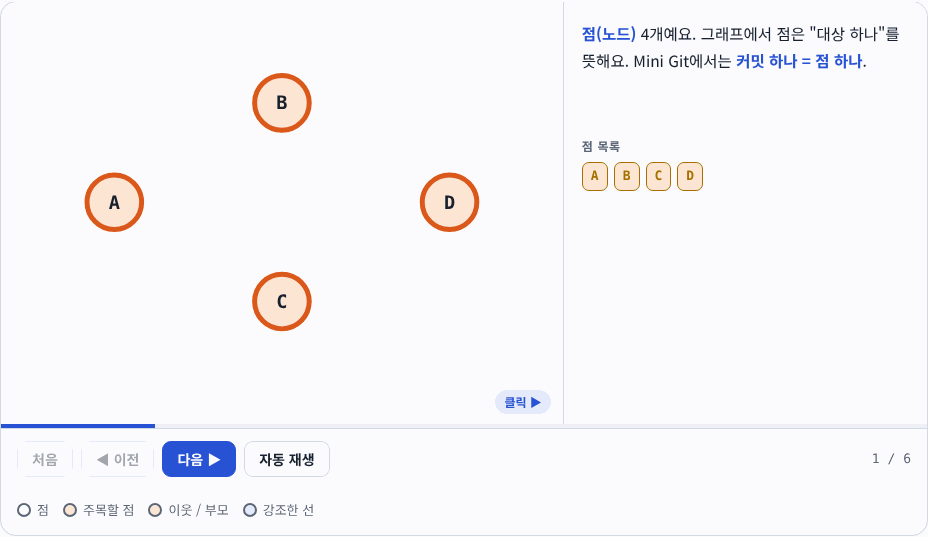](https://raw.githack.com/codewhite7777/codyssey_b5-2/main/docs/index.html#graph)

▶ [클릭해서 한 단계씩 보기](https://raw.githack.com/codewhite7777/codyssey_b5-2/main/docs/index.html#graph)

**한 줄 정의** — 점(노드)과 그 점들을 잇는 선(간선)으로 "무엇과 무엇이 연결돼 있나"를 표현하는 구조예요.

**쉬운 비유** — 지하철 노선도. 역이 점, 역과 역을 잇는 철로가 선이에요.

**왜 필요해? (Mini Git에서)**
- 커밋 하나 = 점 하나, "내 부모는 저 커밋" = 선 하나. Git 이력은 그 자체로 그래프예요.
- `LOG`, `PATH`, `ANCESTORS`는 전부 **이 그래프를 돌아다니는 일**이에요.

**특징 · 용어**
- **이웃**: 선 하나로 바로 이어진 점
- **방향 그래프**: 선에 화살표가 있어서 한쪽으로만 갈 수 있는 그래프
- **인접 리스트**: 점마다 이웃 목록을 저장하는 방법 (`{"A": ["B", "C"], ...}`)

**코드 위치** — Mini Git은 목록을 두 개 둬요.

```python
commits[hash].parents   # 부모 목록 = 위(과거)로 가는 이웃
children[hash]          # 자식 목록 = 아래(미래)로 가는 이웃
```

부모 목록만 있어도 위로는 갈 수 있지만, `LOG`(자식의 진입 차수 줄이기)와 `PATH`(양쪽으로 이동)에는 아래로 가는 목록도 필요해서 `children`을 따로 저장해요.

---

<a id="tree"></a>
## 02. 트리 · 커밋 트리

[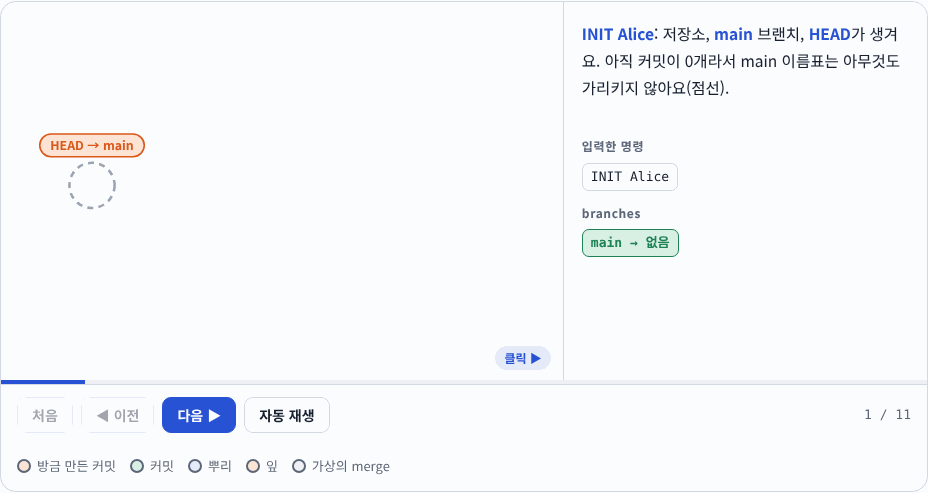](https://raw.githack.com/codewhite7777/codyssey_b5-2/main/docs/index.html#tree)

▶ [클릭해서 한 단계씩 보기](https://raw.githack.com/codewhite7777/codyssey_b5-2/main/docs/index.html#tree)

**한 줄 정의** — 뿌리 하나에서 가지가 갈라져 나가는 그래프예요. 뿌리만 부모가 0개이고, 나머지는 부모가 **딱 1개**예요.

**쉬운 비유** — 회사 조직도. 맨 위 대표(뿌리) 아래로 팀이 갈라지고, 직원 한 명의 직속 상사는 한 명뿐이에요.

**왜 필요해? (Mini Git에서)**
- 이번 과제는 merge(부모 2개)를 만들지 않아서 커밋 이력은 **항상 트리**예요.
- `BRANCH`는 가지를 칠 준비(이름표 추가), `COMMIT`은 지금 가지에 새 잎을 붙이는 일이에요.

**특징 · 용어**

| 용어 | 뜻 | 예 (애니메이션 기준) |
|---|---|---|
| 뿌리 (root) | 부모가 없는 첫 커밋 | C1 |
| 잎 (leaf) | 자식이 없는 끝 커밋 | C2, C4 |
| 깊이 (depth) | 뿌리에서 몇 칸 내려왔나 | C4는 깊이 2 |
| 형제 (sibling) | 부모가 같은 커밋 | C2와 C3 |

- 트리에서는 **조상 수 = 깊이**예요. C4의 조상은 C3, C1 → 2개 = 깊이 2.
- 브랜치는 커밋이 아니라 **이름표**라서, `BRANCH`를 해도 커밋 수는 늘지 않아요.
- `SWITCH`는 HEAD만 옮겨요. 커밋은 그대로예요.

**코드 위치** — `repository.py` · `create_branch()`, `switch()`, `commit()`

```python
def commit(self, message):
    parent = self.head_commit()                     # HEAD가 가리키던 커밋
    parents = [parent] if parent is not None else []
    ...
    self.branches[self.head] = new.hash             # 현재 브랜치 이름표만 한 칸 전진
```

---

<a id="dag"></a>
## 03. DAG와 사이클

[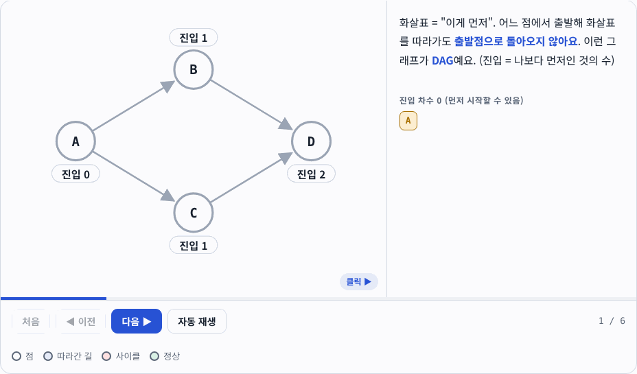](https://raw.githack.com/codewhite7777/codyssey_b5-2/main/docs/index.html#dag)

▶ [클릭해서 한 단계씩 보기](https://raw.githack.com/codewhite7777/codyssey_b5-2/main/docs/index.html#dag)

**한 줄 정의** — **D**irected(방향 있음) + **A**cyclic(고리 없음) + **G**raph. 화살표를 따라가도 제자리로 돌아오지 않는 그래프예요.

**쉬운 비유** — 족보. 할아버지 → 아버지 → 나로만 이어지고, 내가 할아버지의 아버지가 되는 일은 없어요. 그런 고리가 **사이클**이에요.

**왜 필요해? (Mini Git에서)**
- 과제 요구사항: "커밋 그래프는 DAG여야 한다"
- 사이클이 있으면 생기는 문제
  - `LOG`: 모두가 "내 앞 사람 먼저"를 기다려서 **아무도 먼저 출력될 수 없어요** (위상 정렬 불가)
  - `ANCESTORS`: 조상을 따라가면 **끝없이 돌아요**. "내가 내 조상"이라는 말도 안 되는 결과

**특징**
- 트리는 DAG의 한 종류예요 (부모가 1개인 DAG).
- merge 커밋(부모 2개)이 생겨도 사이클이 없으면 여전히 DAG예요.
- **Mini Git에서 사이클이 생길 수 없는 이유**: 새 커밋의 부모는 항상 **이미 있는** 커밋(HEAD)이에요. 아직 없는 미래 커밋을 부모로 둘 방법이 없으니 화살표는 늘 과거를 향해요.

**코드 위치** — `graph.py` · `topological_order()`의 안전장치

```python
if len(order) != len(indegree):
    raise ValueError("cycle detected: commit graph is not a DAG")
```

---

<a id="hashmap"></a>
## 04. 해시맵 (딕셔너리)

[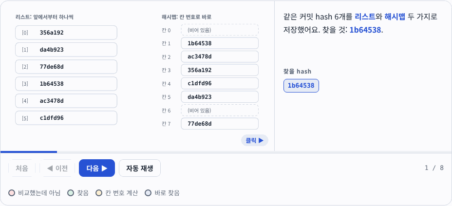](https://raw.githack.com/codewhite7777/codyssey_b5-2/main/docs/index.html#hashmap)

▶ [클릭해서 한 단계씩 보기](https://raw.githack.com/codewhite7777/codyssey_b5-2/main/docs/index.html#hashmap)

**한 줄 정의** — 키로 "칸 번호"를 계산해서, 처음부터 훑지 않고 그 칸으로 **바로** 가는 저장 방법이에요. 파이썬의 `dict`, `set`이 해시맵이에요.

**쉬운 비유** — 사물함. 이름표만 보면 몇 번 사물함인지 바로 알아서 그 칸만 열어요. 리스트는 1번부터 하나씩 다 열어 보는 방식이에요.

**왜 필요해? (Mini Git에서)**
- 과제 요구: "커밋 저장소는 커밋 hash로 빠르게 찾을 수 있어야 한다"
- `PATH 356a192 77de68d`처럼 hash를 받으면 그 커밋을 바로 꺼내야 해요.
- 새 hash를 만들 때 "이미 있나?"를 바로 확인해서 **중복을 막아요**.

**특징**

| 작업 | 리스트 | 해시맵 |
|---|---|---|
| 찾기 | O(N) — 하나씩 비교 | **O(1)** — 칸으로 바로 |
| 있는지 확인 (`in`) | O(N) | **O(1)** |
| 넣기 | O(1) (맨 뒤) | O(1) |

- 애니메이션은 이해하기 쉽게 "첫 글자 % 8"로 칸을 정했어요. 실제 파이썬은 훨씬 복잡한 계산을 하고, 칸이 겹치는 경우(충돌)도 알아서 처리해요.

**코드 위치** — `repository.py`

```python
self.commits = {}                         # hash → Commit (해시맵)

def _new_hash(self):
    while True:
        self._counter += 1
        candidate = hashlib.sha1(str(self._counter).encode()).hexdigest()[:7]
        if candidate not in self.commits:  # O(1) 확인 → 겹치면 다시
            return candidate
```

**hash가 만들어지는 순서**: 카운터(1, 2, 3…) → SHA-1 → 앞 7자리 → 이미 있으면 카운터를 올려 다시. 같은 순서로 명령하면 항상 같은 hash(`356a192`, `da4b923`, `77de68d`, `1b64538`…)가 나와요.

---

<a id="queue"></a>
## 05. 큐 (Queue)

[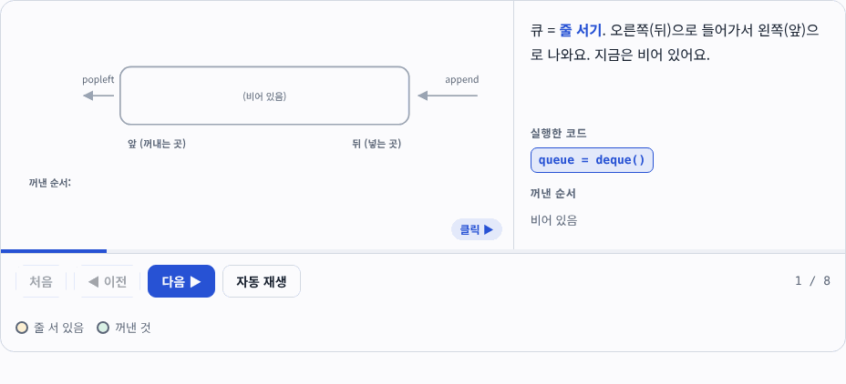](https://raw.githack.com/codewhite7777/codyssey_b5-2/main/docs/index.html#queue)

▶ [클릭해서 한 단계씩 보기](https://raw.githack.com/codewhite7777/codyssey_b5-2/main/docs/index.html#queue)

**한 줄 정의** — 뒤로 들어가서 앞으로 나오는 줄이에요. 먼저 들어온 것이 먼저 나와요(**FIFO**: First In, First Out).

**쉬운 비유** — 편의점 계산 줄. 먼저 온 손님이 먼저 계산하고, 새 손님은 맨 뒤에 서요.

**왜 필요해? (Mini Git에서)**
- BFS와 위상 정렬은 "다음에 처리할 것"을 큐에 줄 세워요.
- **먼저 발견한(가까운) 것을 먼저 처리**해야 BFS가 가까운 순서를 지킬 수 있어요.

**특징**
- 파이썬은 `collections.deque`를 써요. `append`(뒤에 넣기), `popleft`(앞에서 꺼내기) 모두 **O(1)**.
- `list.pop(0)`도 앞에서 꺼내지만, 나머지를 한 칸씩 당겨야 해서 **O(n)**으로 느려요.
- 반대 개념: **스택**(접시 쌓기, LIFO). 마지막에 넣은 것을 먼저 꺼내요. DFS가 써요.

**코드 위치** — `graph.py` 맨 위 `from collections import deque`

---

<a id="bfs"></a>
## 06. BFS (너비 우선 탐색)

[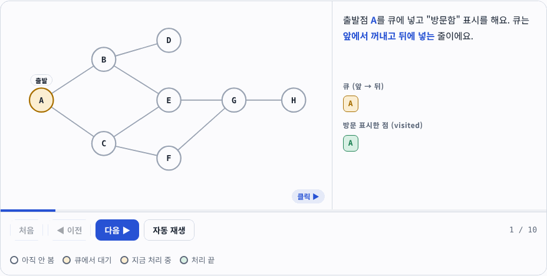](https://raw.githack.com/codewhite7777/codyssey_b5-2/main/docs/index.html#bfs)

▶ [클릭해서 한 단계씩 보기](https://raw.githack.com/codewhite7777/codyssey_b5-2/main/docs/index.html#bfs)

**한 줄 정의** — 가까운 곳부터 한 겹씩 넓혀 가며, 연결된 점을 **하나도 빠뜨리지 않고** 둘러보는 방법이에요.

**쉬운 비유** — 호수에 돌을 던지면 물결이 동그랗게 퍼지죠. 바로 옆(1겹)을 먼저 다 적시고, 그다음 2겹, 3겹으로 가요.

**왜 필요해? (Mini Git에서)**
- `PATH`(최단 경로)와 `ANCESTORS`(조상 탐색)가 BFS를 그대로 써요.
- 같은 점을 두 번 보지 않으니 merge로 길이 여러 개여도 중복이 없어요.

**동작 순서**
1. 출발점을 큐에 넣고 "방문함" 표시
2. 큐 맨 앞에서 하나 꺼냄
3. 그 점의 이웃 중 처음 보는 것을 큐 뒤에 넣고 "방문함" 표시
4. 큐가 빌 때까지 2~3 반복

**특징**
- 재료: **큐** + **visited**(방문 표시) 집합
- 방문 순서가 **가까운 순서(거리 순)**로 보장돼요.
- 시간 **O(V + E)**: 점(V)마다 한 번, 선(E)마다 한 번씩만 봐요.
- ⚠ 흔한 실수: 방문 표시를 꺼낼 때 하면 같은 점이 줄에 여러 번 서요. **넣을 때** 표시하세요.

**코드 위치** — `graph.py` · `bfs_order()`, `bfs_distances()`

```python
def bfs_order(start, neighbors):
    visited = {start}
    order = [start]
    queue = deque([start])
    while queue:
        node = queue.popleft()
        for nxt in neighbors(node):
            if nxt not in visited:
                visited.add(nxt)
                order.append(nxt)
                queue.append(nxt)
    return order
```

`neighbors`를 **함수로** 받는 게 핵심이에요. 부모 목록을 넘기면 조상 탐색, 부모+자식을 넘기면 무방향 탐색이 돼요(같은 코드 재사용).

---

<a id="path"></a>
## 07. 최단 경로

[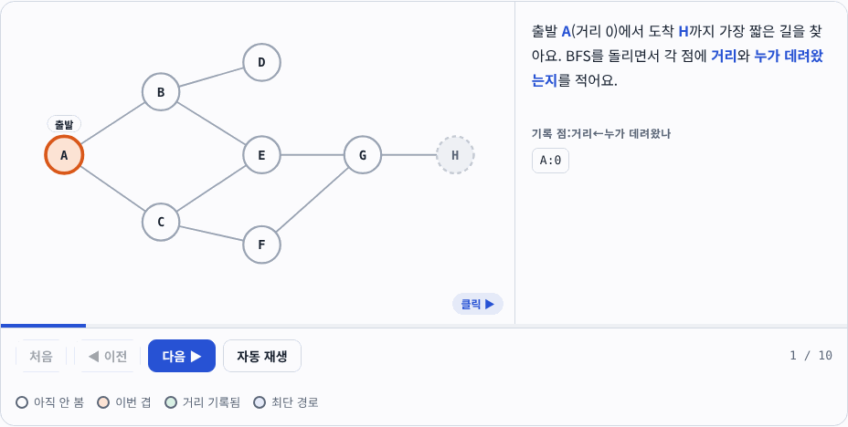](https://raw.githack.com/codewhite7777/codyssey_b5-2/main/docs/index.html#path)

▶ [클릭해서 한 단계씩 보기](https://raw.githack.com/codewhite7777/codyssey_b5-2/main/docs/index.html#path)

**한 줄 정의** — BFS를 돌리면서 "누가 나를 데려왔는지"를 적어 두고, 도착하면 그 기록을 **거꾸로** 따라가 길을 만드는 방법이에요.

**쉬운 비유** — 지하철에서 정거장 수가 가장 적은 길 찾기. 1정거장 거리 역을 다 표시하고, 2정거장, 3정거장… 목적지가 **처음** 표시되는 순간이 가장 가까운 거리예요.

**왜 필요해? (Mini Git에서)**
- `PATH <커밋1> <커밋2>`: 두 커밋이 이력상 몇 칸 떨어졌는지
- 경로가 없으면 `No path`

**왜 BFS로 최단 경로가 나올까?** BFS는 거리 1인 점을 **전부** 본 다음에야 거리 2로 넘어가요. 그래서 어떤 점에 처음 닿은 순간의 거리가 그 점까지의 가장 짧은 거리예요.

**왜 간선을 무방향으로 볼까?** 다른 브랜치의 두 커밋은 서로의 조상이 아니라서, 부모 방향으로만 가면 영원히 못 만나요. 양쪽으로 다닐 수 있게 하면 **공통 조상까지 올라갔다가 다른 가지로 내려오는 길**이 생겨요.

**특징**
- 모든 선의 비용이 **똑같이 1**일 때만 BFS가 정답이에요. 비용이 다르면 다익스트라 같은 다른 방법이 필요해요.
- 도착점이 끝까지 안 나오면 → 경로 없음 (`No path`)
- 시간 **O(V + E)**

---

<a id="lexpath"></a>
## 08. PATH 사전순 규칙 (Mini Git 방식)

[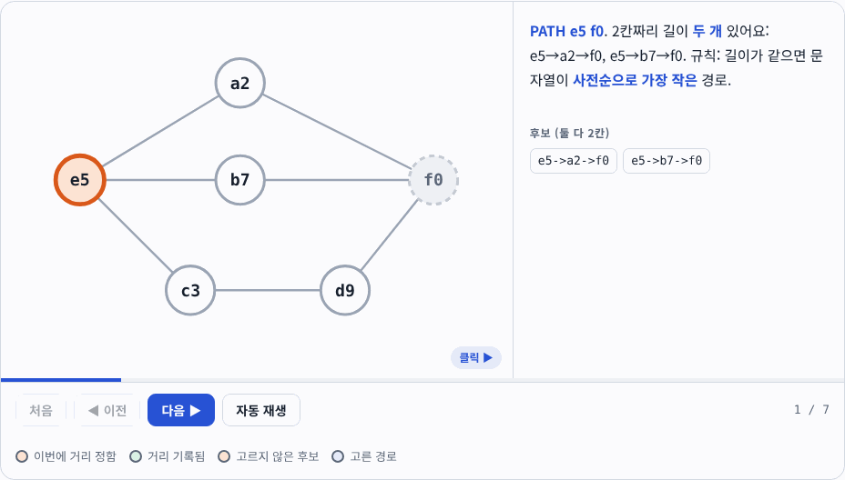](https://raw.githack.com/codewhite7777/codyssey_b5-2/main/docs/index.html#lexpath)

▶ [클릭해서 한 단계씩 보기](https://raw.githack.com/codewhite7777/codyssey_b5-2/main/docs/index.html#lexpath)

**한 줄 정의** — 최단 경로가 여러 개면 `hash1->hash2->...` 문자열이 **사전순으로 가장 작은** 경로를 골라요(과제 규칙).

**쉬운 비유** — 칸마다 "도착까지 남은 거리"가 적힌 지도를 들고, 갈림길마다 남은 거리가 1 줄어드는 길 중 **이름이 가장 앞인 길**로 가는 거예요.

**방법 (2단계)**
1. **도착점**에서 BFS를 돌려 모든 점의 "도착까지 남은 거리"를 구해요.
2. **출발점**에서 출발해, 남은 거리가 정확히 1 줄어드는 이웃 중 **hash가 가장 작은 것**을 골라 한 칸씩 이동해요.

**왜 한 칸씩 작은 걸 고르면 전체도 가장 작을까?** hash 길이가 모두 7자리로 같아요. 문자열 비교는 앞에서부터 하니까, 첫 칸에서 작은 걸 고르면 그 뒤가 뭐든 더 작은 문자열이 돼요.

**언제 실제로 생기나** — 같은 길이의 경로가 여러 개 생기려면 merge(부모 2개)가 필요해요. 이번 과제는 merge를 만들지 않아서 CLI로는 안 생기지만, 규칙은 코드에 들어 있고 [EVALUATION.md 1-4](EVALUATION.md#1-4-path)에 직접 확인하는 명령이 있어요.

**코드 위치** — `graph.py` · `shortest_path()`

```python
dist = bfs_distances(goal, neighbors)     # ① 도착점에서 거리 재기
if start not in dist:
    return None                           # No path
path, node = [start], start
while node != goal:
    best = None
    for nxt in neighbors(node):           # ② 거리가 1 줄어드는 이웃 중 가장 작은 hash
        if dist.get(nxt) == dist[node] - 1 and (best is None or nxt < best):
            best = nxt
    path.append(best)
    node = best
```

---

<a id="ancestors"></a>
## 09. 조상 탐색

[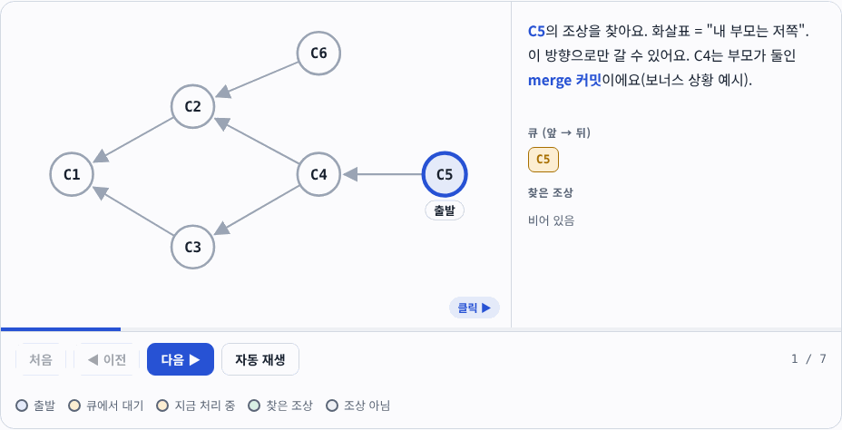](https://raw.githack.com/codewhite7777/codyssey_b5-2/main/docs/index.html#ancestors)

▶ [클릭해서 한 단계씩 보기](https://raw.githack.com/codewhite7777/codyssey_b5-2/main/docs/index.html#ancestors)

**한 줄 정의** — 부모 쪽 화살표만 따라 끝까지 올라가는 BFS예요. BFS에서 "이웃 = 부모"로만 바꾸면 돼요.

**쉬운 비유** — 족보 거슬러 올라가기. 나 → 부모님 → 조부모님. 형제나 사촌은 위로 올라가서 닿는 사람이 아니니 조상이 아니에요.

**왜 필요해? (Mini Git에서)**
- `ANCESTORS <hash>`: "도달 가능한 모든 조상을 빠짐없이"
- "이 커밋에는 어떤 변경들이 다 들어 있나?" = 조상 전부

**특징**
- **방향이 있는** BFS (부모 방향만)
- merge가 있으면 같은 조상을 **두 길로** 만날 수 있어요 → visited가 있어서 한 번만 출력
- 형제 가지는 절대 안 나와요
- 애니메이션은 merge 커밋(C4)이 있는 예시라 visited가 왜 필요한지 보여 줘요(이번 과제 CLI에서는 merge가 안 생겨요).

**코드 위치** — `graph.py` · `find_ancestors()`

```python
def find_ancestors(start, parents_of):
    return bfs_order(start, parents_of)[1:]   # BFS 그대로, 이웃 = 부모. 자기 자신만 빼기
```

---

<a id="topo"></a>
## 10. 위상 정렬

[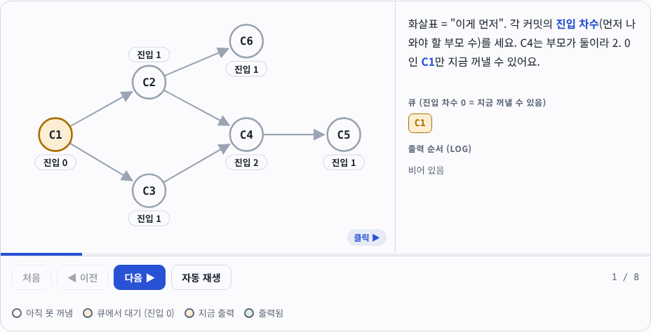](https://raw.githack.com/codewhite7777/codyssey_b5-2/main/docs/index.html#topo)

▶ [클릭해서 한 단계씩 보기](https://raw.githack.com/codewhite7777/codyssey_b5-2/main/docs/index.html#topo)

**한 줄 정의** — "먼저 해야 하는 것"이 항상 앞에 오도록 줄을 세우는 방법이에요. 조건이 다 풀린 것부터 하나씩 꺼내요.

**쉬운 비유** — 수강신청의 선수과목. "자료구조"를 들어야 "알고리즘"을 들을 수 있죠. 남은 선수과목이 없는 과목만 지금 들을 수 있어요. 옷 입기도 같아요(양말 → 신발).

**왜 필요해? (Mini Git에서)**
- `LOG`: 과제 요구 "부모 커밋이 항상 자식 커밋보다 먼저 출력"
- 시간순 정렬은 컴퓨터 시계가 틀리면 깨지지만, 위상 정렬은 **부모-자식 관계**로 정해서 절대 안 깨져요.

**동작 순서 (Kahn 알고리즘)**
1. 커밋마다 **진입 차수** = 먼저 나와야 할 부모 수를 세요.
2. 진입 차수가 0인 커밋(뿌리)을 큐에 넣어요.
3. 큐에서 하나 꺼내 출력하고, 그 **자식들의 진입 차수를 1씩** 줄여요.
4. 0이 된 자식을 큐에 넣고, 큐가 빌 때까지 반복해요.

진입 차수가 0이 됐다 = "내 부모가 모두 이미 출력됐다"는 뜻이라서, 부모 먼저 조건이 저절로 지켜져요.

**특징**
- 사이클이 있으면 진입 차수 0인 점이 없어서 **불가능** (DAG에서만 됨)
- 정답이 여러 개일 수 있어요. Mini Git은 처음 큐에 **커밋을 만든 순서대로** 넣어서, 동시에 나갈 수 있는 커밋끼리는 먼저 만든 것이 먼저 나와요.
- 시간 **O(V + E)**

**코드 위치** — `graph.py` · `topological_order()` → `repository.py` · `log_topological()`

---

<a id="mergesort"></a>
## 11. 병합 정렬 · 안정 정렬

[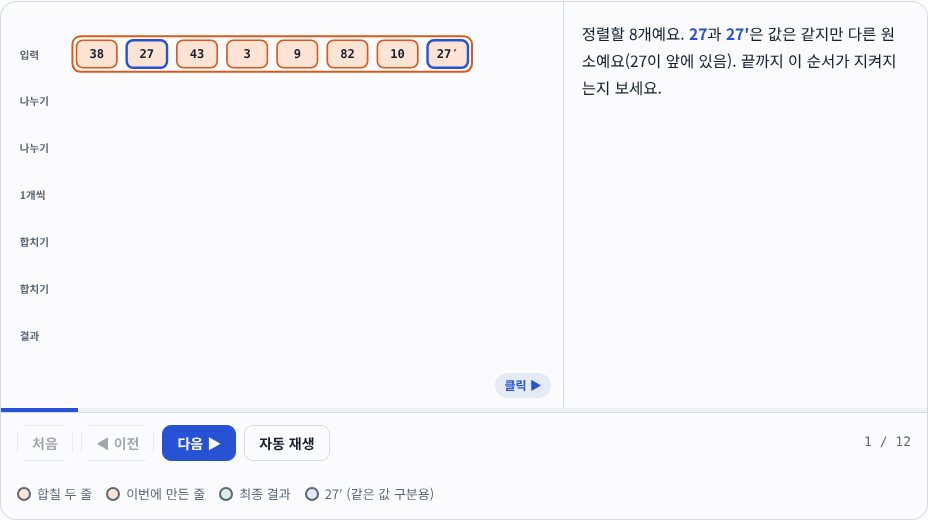](https://raw.githack.com/codewhite7777/codyssey_b5-2/main/docs/index.html#mergesort)

▶ [클릭해서 한 단계씩 보기](https://raw.githack.com/codewhite7777/codyssey_b5-2/main/docs/index.html#mergesort)

**한 줄 정의** — 반으로 계속 쪼개서 1개씩 만든 다음, 정렬된 두 줄을 **맨 앞끼리 비교**하며 하나로 합쳐 올라가는 방법이에요.

**쉬운 비유** — 시험지 묶음을 이름순으로 정리할 때 둘로 나눠 두 사람이 각자 정리해요. 그다음 두 묶음의 맨 위 장끼리만 비교해서 앞인 것을 내려놓으면 금방 합쳐져요.

**왜 필요해? (Mini Git에서)**
- 과제가 `sorted()`, `list.sort()`를 **금지**해서 직접 만들어야 해요.
- `LOG --sort-by=date|author`에서 기준(key)만 바꿔 같은 함수로 정렬해요.

**안정 정렬이란?** 값이 같은 것끼리는 **원래 순서가 그대로 유지**되는 정렬이에요. 작성자순으로 정렬할 때 같은 작성자의 커밋이 만든 순서 그대로 나오니까 결과를 예측할 수 있어요. 병합 정렬은 합칠 때 값이 같으면 **왼쪽(원래 앞에 있던 것)을 먼저** 넣어서 안정 정렬이 돼요.

**특징**

| | 병합 정렬 (Mini Git) | 퀵 정렬 | 삽입 정렬 |
|---|---|---|---|
| 평균 | O(n log n) | O(n log n) | O(n²) |
| 최악 | **O(n log n)** | O(n²) | O(n²) |
| 안정 정렬 | **예** | 아니오 | 예 |
| 추가 메모리 | O(n) | O(log n) | O(1) |

**왜 항상 n log n?** 반씩 나누면 층이 log n개(8개면 3층). 층마다 n개를 한 번씩 비교하며 합쳐요. 그래서 n × log n.

**코드 위치** — `sorting.py` · `merge_sort(items, key)`

```python
merge_sort(commits, key=lambda c: c.timestamp)       # --sort-by=date
merge_sort(commits, key=lambda c: c.author.lower())  # --sort-by=author

# _merge 안의 핵심 한 줄
if key(right[j]) < key(left[i]):   # 오른쪽이 "더 작을 때만" 오른쪽 먼저 → 같으면 왼쪽 먼저 = 안정
```

---

<a id="index"></a>
## 12. 역색인 (Inverted Index)

[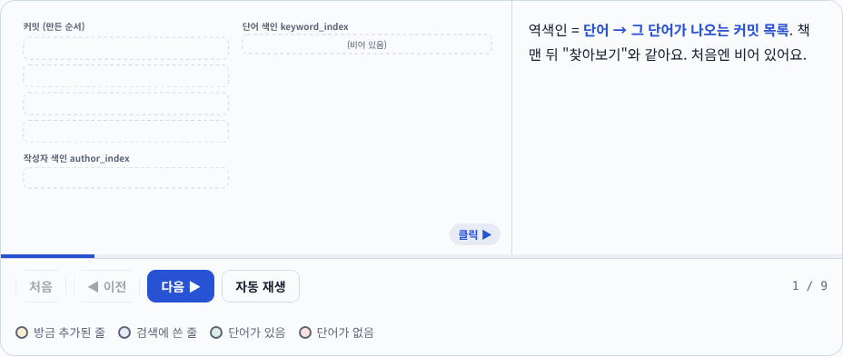](https://raw.githack.com/codewhite7777/codyssey_b5-2/main/docs/index.html#index)

▶ [클릭해서 한 단계씩 보기](https://raw.githack.com/codewhite7777/codyssey_b5-2/main/docs/index.html#index)

**한 줄 정의** — "단어 → 그 단어가 나오는 커밋 목록"을 **커밋할 때 미리** 적어 두고, 검색할 때는 꺼내기만 하는 방법이에요.

**쉬운 비유** — 책 맨 뒤의 "찾아보기". '해시' 항목을 보면 몇 쪽에 나오는지 바로 알 수 있어서 책 전체를 넘겨 볼 필요가 없어요.

**왜 "역(逆)"색인?** 보통은 "커밋 → 메시지(단어들)"로 저장하죠. 그걸 **거꾸로** "단어 → 커밋들"로 뒤집어 저장해서 역색인이에요.

**왜 필요해? (Mini Git에서)**
- 과제 요구: "검색 시 모든 커밋을 순회하지 않고 후보를 빠르게 가져올 것"
- `SEARCH <단어>` → 단어 색인, `SEARCH --author=<이름>` → 작성자 색인 (최소 2종)

**만드는 규칙** — 커밋 메시지를 **공백으로 나누고(split) 소문자로 바꾼(lower)** 단어마다 이 커밋 hash를 목록에 추가해요.
`"Add Login feature"` → `["add", "login", "feature"]`

**특징**

| | 순회 검색 | 역색인 |
|---|---|---|
| 검색할 때 | 모든 메시지를 다 읽음 **O(N × L)** | 사전에서 한 번 찾기 **O(1) + 결과 수** |
| 커밋할 때 | 할 일 없음 | 단어 수만큼 추가 |
| 커밋이 10배가 되면 | 검색도 10배 느려짐 | 결과 수가 같으면 그대로 |

(N = 커밋 수, L = 메시지 길이)

- 핵심 아이디어: **커밋은 한 번, 검색은 여러 번**이니까 일을 커밋할 때로 미리 옮겨 둔 거예요.
- 여러 단어 검색(`"login bug"`)은 각 단어 목록의 **교집합**이에요.

**코드 위치** — `index.py` · `tokenize()`, `InvertedIndex` / `repository.py` · `commit()` 맨 끝에서 색인 갱신

---

<a id="bigo"></a>
## 13. 시간복잡도 (Big-O)

**한 줄 정의** — 데이터가 늘어날 때 **일이 얼마나 빨리 늘어나는지**를 나타내는 표기예요. 정확한 시간(초)이 아니라 **늘어나는 모양**을 봐요.

**쉬운 비유** — 이름으로 친구 찾기. 반 명단을 처음부터 읽으면 반 인원이 늘수록 오래 걸려요(O(n)). 출석번호를 알면 인원과 상관없이 바로 찾아요(O(1)).

| 표기 | 읽는 법 | n = 10 | n = 1,000 | n = 1,000,000 | Mini Git 예 |
|---|---|---:|---:|---:|---|
| O(1) | 상수 | 1 | 1 | 1 | `commits[hash]`, 역색인 조회 |
| O(log n) | 로그 | 3 | 10 | 20 | 병합 정렬의 층 수 |
| O(n) | 선형 | 10 | 1,000 | 1,000,000 | 리스트에서 찾기, 순회 검색 |
| O(n log n) | 엔 로그 엔 | 33 | 10,000 | 20,000,000 | 병합 정렬 |
| O(n²) | 제곱 | 100 | 1,000,000 | 1,000,000,000,000 | 삽입 정렬 최악 |
| O(V + E) | 점 + 선 | — | — | — | BFS, 위상 정렬 |

(숫자는 대략적인 일의 양)

- **평균 vs 최악**: 평균은 보통 입력일 때, 최악은 가장 운 나쁜 입력일 때예요. 병합 정렬은 둘 다 O(n log n)이라 안정적이에요.
- 평가표 항목 4 "커밋이 10배가 되면?"은 이 표로 답해요. O(1)은 그대로, O(n)은 10배, O(n log n)은 10배보다 조금 더.

---

<a id="selfcheck"></a>
## ✅ 스스로 점검하기

피어 평가에서는 **말로 설명할 수 있는지**를 봐요. 답을 보기 전에 소리 내어 먼저 설명해 보세요.

<details>
<summary><b>Q1. 브랜치와 커밋은 뭐가 달라요?</b></summary>

커밋은 한 번 만들면 바뀌지 않는 **기록**이고, 브랜치는 어떤 커밋을 가리키는 **이름표**예요. 커밋하면 현재 브랜치 이름표만 새 커밋으로 한 칸 이동해요. 그래서 `BRANCH`를 해도 커밋 수는 늘지 않아요.
</details>

<details>
<summary><b>Q2. 왜 커밋 그래프는 DAG여야 하고, Mini Git에서는 어떻게 보장돼요?</b></summary>

사이클이 있으면 "부모 먼저" 순서를 정할 수 없고(LOG 불가), 조상 찾기가 끝나지 않아요. Mini Git은 새 커밋의 부모가 항상 이미 있는 커밋(HEAD)이라 화살표가 늘 과거를 향해서 사이클이 생길 수 없어요. 그래도 `topological_order()`는 사이클을 발견하면 에러를 내요.
</details>

<details>
<summary><b>Q3. LOG에서 부모가 항상 먼저 나오는 이유는?</b></summary>

위상 정렬(Kahn)을 써요. 진입 차수(부모 수)가 0인 커밋만 출력하고, 출력할 때마다 자식의 진입 차수를 1씩 줄여요. 진입 차수가 0이 됐다는 건 부모가 전부 이미 출력됐다는 뜻이라서 조건이 저절로 지켜져요.
</details>

<details>
<summary><b>Q4. PATH는 왜 BFS를 쓰고, 왜 무방향으로 봐요?</b></summary>

모든 선의 비용이 1로 같아서, 가까운 순서로 방문하는 BFS에서 처음 닿은 거리가 최단 거리예요. 무방향으로 보는 이유는 다른 가지의 두 커밋은 서로 조상이 아니라서, 부모 방향만으로는 못 만나기 때문이에요. 공통 조상까지 올라갔다 내려오는 길이 필요해요.
</details>

<details>
<summary><b>Q5. 병합 정렬의 시간복잡도와 안정 정렬 여부는?</b></summary>

평균·최악 모두 O(n log n)이에요. 반씩 나누면 층이 log n개이고 층마다 n번 비교해요. 합칠 때 값이 같으면 왼쪽(원래 앞)을 먼저 넣어서 안정 정렬이에요.
</details>

<details>
<summary><b>Q6. 역색인이 순회 검색보다 빠른 이유는?</b></summary>

순회 검색은 커밋 메시지를 전부 읽어서 O(N × L)이에요. 역색인은 커밋할 때 미리 "단어 → 커밋 목록"을 해시맵에 적어 두기 때문에, 검색할 때는 키 하나로 O(1)에 꺼내고 결과 수만큼만 복사해요.
</details>

<details>
<summary><b>Q7. hash가 겹치지 않는 건 어떻게 보장해요?</b></summary>

카운터를 1씩 올려 SHA-1에 넣고 앞 7자리를 써요. 혹시 7자리가 이미 있으면(`candidate in self.commits`, 해시맵이라 O(1)) 카운터를 올려 다시 만들어요. 그래서 세션 안에서 중복이 0이에요.
</details>

<details>
<summary><b>Q8. BFS 코드 하나로 PATH와 ANCESTORS를 어떻게 같이 써요?</b></summary>

BFS 함수가 "이웃을 돌려주는 함수"를 인자로 받아요. ANCESTORS에는 부모 목록 함수를, PATH에는 부모+자식 목록 함수를 넘겨요. 탐색 코드는 그대로이고 넘기는 함수만 달라요.
</details>

---

더 깊은 평가표 답변은 [EVALUATION.md](EVALUATION.md), 실행 방법과 전체 흐름은 [README.md](README.md)에 있어요.
