# 평가표 항목별 정리

> 평가 체크리스트의 질문마다 **답 → 확인 방법 → 코드 위치 → 그림** 순서로 정리했습니다.
> 실행 예시의 hash는 같은 순서로 입력하면 **항상 같은 값**이 나옵니다. 시간(timestamp)만 실행 시각에 따라 다릅니다.
> 처음부터 읽으려면 → [README.md](README.md)

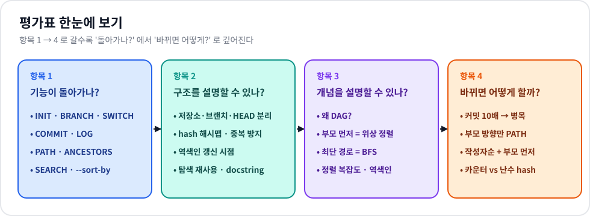

## 목차

- [항목 1 · 기능이 돌아가나?](#항목-1--기능이-돌아가나)
- [항목 2 · 구조를 설명할 수 있나?](#항목-2--구조를-설명할-수-있나)
- [항목 3 · 개념을 설명할 수 있나?](#항목-3--개념을-설명할-수-있나)
- [항목 4 · 바뀌면 어떻게 할까?](#항목-4--바뀌면-어떻게-할까)

---

## 항목 1 · 기능이 돌아가나?

모든 확인은 `python main.py` 를 실행한 뒤 아래 명령을 그대로 입력하면 됩니다.

### 1-1. INIT

**Q. `INIT <user_name>` 실행 후 main 브랜치 / HEAD / 현재 사용자가 정상 초기화되는가?**

```text
mini-git> init "Alice"
Initialized repository.
Current branch: main
Current user: Alice
mini-git> commit "Initial commit"
[main 356a192] Initial commit
mini-git> log
commit 356a192 (Alice, 2026-10-19 09:00:00) [HEAD -> main]
    parents: (none)
    Initial commit
```

- `Current branch: main` → main 브랜치 생성, HEAD = main
- 첫 커밋이 `[main ...]` 으로 찍히고 LOG에 `HEAD -> main`, 작성자 `Alice` → 세 가지 모두 설정됨
- INIT 전에 다른 명령을 치면 `Not initialized. Run INIT <user_name> first.`
- 코드: `main.py` `cmd_init()` → `minigit/repository.py` `Repository.__init__()`

### 1-2. BRANCH · SWITCH · COMMIT

**Q. `BRANCH <name>` 생성 후 `SWITCH <name>` 으로 전환되고, 이후 COMMIT이 그 브랜치에 반영되는가?**

```text
mini-git> branch feature
Created branch: feature
mini-git> switch feature
Switched to branch: feature
mini-git> commit "Add login feature"
[feature da4b923] Add login feature
mini-git> switch main
Switched to branch: main
mini-git> commit "Add payment feature"
[main 77de68d] Add payment feature
mini-git> log
commit 356a192 (Alice, 2026-10-19 09:00:00)
    parents: (none)
    Initial commit
commit da4b923 (Alice, 2026-10-19 09:15:00) [feature]
    parents: 356a192
    Add login feature
commit 77de68d (Alice, 2026-10-19 09:30:00) [HEAD -> main]
    parents: 356a192
    Add payment feature
```

- `[feature da4b923]` → feature 브랜치에 커밋됨, LOG에서 `feature` 이름표가 `da4b923` 을 가리킴
- main으로 돌아와 커밋한 `77de68d` 의 부모는 `da4b923` 이 아니라 `356a192` → 브랜치별로 따로 쌓임
- 코드: `Repository.create_branch()`, `switch()`, `commit()`

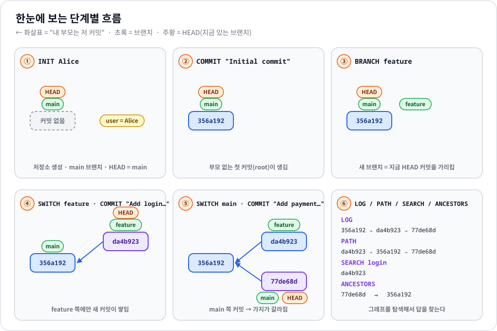

### 1-3. LOG

**Q. LOG가 "부모 커밋이 자식 커밋보다 먼저" 출력되는가?**

이어서:

```text
mini-git> init "Bob"
Repository already initialized.
Current user: Bob
mini-git> commit "Fix login bug"
[main 1b64538] Fix login bug
mini-git> log
commit 356a192 (Alice, 2026-10-19 09:00:00)
    parents: (none)
    Initial commit
commit da4b923 (Alice, 2026-10-19 09:15:00) [feature]
    parents: 356a192
    Add login feature
commit 77de68d (Alice, 2026-10-19 09:30:00)
    parents: 356a192
    Add payment feature
commit 1b64538 (Bob, 2026-10-19 09:45:00) [HEAD -> main]
    parents: 77de68d
    Fix login bug
```

- 확인 방법: 각 커밋의 `parents:` 에 적힌 hash가 **반드시 그 커밋보다 위에** 있습니다.
- 코드: `Repository.log_topological()` → `minigit/graph.py` `topological_order()` (→ [3-2](#3-2-log-위상-정렬))

### 1-4. PATH

**Q. `PATH <a> <b>` 가 경로가 있으면 최단 경로를, 없으면 `No path` 를 출력하는가?**

경로가 있을 때 (이어서):

```text
mini-git> path da4b923 1b64538
Path: da4b923 -> 356a192 -> 77de68d -> 1b64538
mini-git> path 356a192 77de68d
Path: 356a192 -> 77de68d
mini-git> path 77de68d 77de68d
Path: 77de68d
```

경로가 없을 때 (새로 실행): 첫 커밋 전에 브랜치를 만들면 root가 2개인, 서로 이어지지 않은 그래프가 생깁니다.

```text
mini-git> init "Alice"
Initialized repository.
Current branch: main
Current user: Alice
mini-git> branch island
Created branch: island
mini-git> commit "Initial commit"
[main 356a192] Initial commit
mini-git> switch island
Switched to branch: island
mini-git> commit "Island root"
[island da4b923] Island root
mini-git> path 356a192 da4b923
No path
```

최단 경로가 여러 개일 때 사전순 최소 경로를 고르는지 확인 (merge가 있어야 생기는 상황이라 함수로 직접 확인):

```bash
python -c "from minigit.graph import shortest_path; p={'a':[],'b':['a'],'c':['a'],'d':['b','c']}; ch={'a':['b','c'],'b':['d'],'c':['d'],'d':[]}; print(shortest_path('a','d',lambda n:p[n]+ch[n]))"
# ['a', 'b', 'd']   ← a->b->d 와 a->c->d 둘 다 2칸, 사전순으로 작은 쪽
```

- 코드: `Repository.path()` → `graph.py` `shortest_path()` (→ [3-3](#3-3-path-bfs와-무방향-간선))

### 1-5. ANCESTORS

**Q. `ANCESTORS <hash>` 가 모든 조상을 빠짐없이 출력하는가?**

```text
mini-git> ancestors 1b64538
Ancestors of 1b64538 (2 commits):
- 77de68d: Add payment feature (Alice)
- 356a192: Initial commit (Alice)
mini-git> ancestors 356a192
No ancestors: 356a192 is a root commit
mini-git> ancestors abc1234
Unknown commit: abc1234
```

- `1b64538 → 77de68d → 356a192` 로 부모를 끝까지 따라감. 형제 가지 `da4b923` 은 조상이 아니므로 제외.
- BFS + `visited` 집합 → 도달 가능한 조상은 전부, 각각 한 번씩.
- 코드: `Repository.ancestors()` → `graph.py` `find_ancestors()`

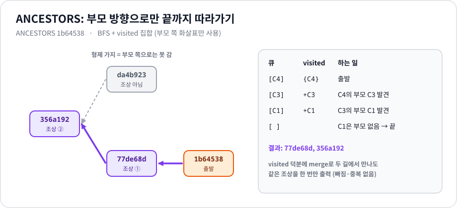

### 1-6. SEARCH / LOG --sort-by

**Q. `SEARCH <keyword>` / `SEARCH --author=<name>` / `LOG --sort-by=date|author` 가 요구사항대로 동작하는가?**

1-3에 이어서:

```text
mini-git> search "login"
Found 2 commits:
- da4b923: Add login feature (Alice)
- 1b64538: Fix login bug (Bob)
mini-git> search LOGIN
Found 2 commits:
- da4b923: Add login feature (Alice)
- 1b64538: Fix login bug (Bob)
mini-git> search "add feature"
Found 2 commits:
- da4b923: Add login feature (Alice)
- 77de68d: Add payment feature (Alice)
mini-git> search --author=bob
Found 1 commit:
- 1b64538: Fix login bug (Bob)
mini-git> search nothing
No commits found.
```

정렬은 작성자가 섞여야 잘 보이므로 새로 실행합니다 (Zoe → Alice → Zoe → Bob 순서로 커밋):

```text
mini-git> init "Zoe"
mini-git> commit "Initial commit"
[main 356a192] Initial commit
mini-git> init "Alice"
mini-git> commit "Add login"
[main da4b923] Add login
mini-git> init "Zoe"
mini-git> commit "Fix typo"
[main 77de68d] Fix typo
mini-git> init "Bob"
mini-git> commit "Add docs"
[main 1b64538] Add docs
mini-git> log --sort-by=author
commit da4b923 (Alice, 2026-10-19 09:01:00)
    parents: 356a192
    Add login
commit 1b64538 (Bob, 2026-10-19 09:03:00) [HEAD -> main]
    parents: 77de68d
    Add docs
commit 356a192 (Zoe, 2026-10-19 09:00:00)
    parents: (none)
    Initial commit
commit 77de68d (Zoe, 2026-10-19 09:02:00)
    parents: da4b923
    Fix typo
mini-git> log --sort-by=date
commit 356a192 (Zoe, 2026-10-19 09:00:00)
    parents: (none)
    Initial commit
commit da4b923 (Alice, 2026-10-19 09:01:00)
    parents: 356a192
    Add login
commit 77de68d (Zoe, 2026-10-19 09:02:00)
    parents: da4b923
    Fix typo
commit 1b64538 (Bob, 2026-10-19 09:03:00) [HEAD -> main]
    parents: 77de68d
    Add docs
```

(`init` 의 안내 문구는 줄였습니다.)

- 작성자순: Alice → Bob → Zoe. Zoe의 두 커밋은 **만든 순서(356a192 → 77de68d) 그대로** → 안정 정렬
- 날짜순: timestamp 오름차순
- 코드: `Repository.search_keyword()`, `search_author()`, `log_sorted()` → `sorting.py` `merge_sort()`

---

## 항목 2 · 구조를 설명할 수 있나?

### 2-1. 저장소 · 브랜치 · HEAD · 사용자 분리

**Q. 커밋 저장소 / 브랜치 / HEAD / 사용자 정보를 어떤 구조로 분리했고, 각 책임은?**

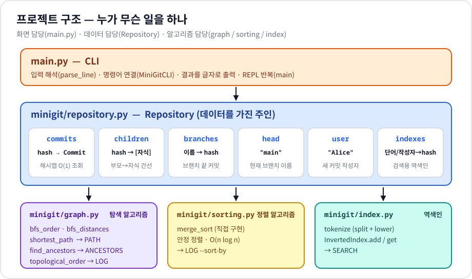

| 데이터 | 구조 | 책임 |
|---|---|---|
| `commits` | `dict[hash → Commit]` | 커밋 노드 보관, hash로 O(1) 조회 |
| `children` | `dict[hash → list[hash]]` | 부모→자식 방향 간선 (LOG의 진입 차수 감소, PATH의 무방향 이동) |
| `branches` | `dict[이름 → hash 또는 None]` | 브랜치 = 커밋을 가리키는 이름표. 커밋하면 이 값만 바뀜 |
| `head` | `str` (브랜치 이름) | "지금 어느 브랜치에 있나". 실제 Git처럼 커밋이 아니라 **브랜치를 가리킴** |
| `user` | `str` | 새 커밋의 author |
| `keyword_index`, `author_index` | `InvertedIndex` | 검색 전용 |

- 커밋은 한 번 만들어지면 **바뀌지 않는 기록**, 브랜치와 HEAD는 **움직이는 포인터**라서 따로 둡니다. 브랜치를 옮겨도 커밋 데이터는 건드리지 않습니다.
- HEAD를 커밋 hash가 아니라 브랜치 이름으로 저장하므로, 커밋 후 `branches[head]` 한 곳만 바꾸면 "현재 브랜치가 한 칸 전진"이 됩니다.
- 화면 처리(`main.py`) / 데이터(`Repository`) / 알고리즘(`graph`, `sorting`, `index`)을 파일 단위로 나눴습니다.

### 2-2. hash 조회 구조와 중복 방지

**Q. 커밋 hash로 빠르게 조회하기 위해 어떤 키-값 구조를 썼고, 중복/충돌은 어떻게 막았나?**

- `self.commits = {hash: Commit}` — 파이썬 `dict`(해시 테이블)라 조회 · 존재 확인이 평균 **O(1)**.
- hash 생성 (`Repository._new_hash()`):

```python
while True:
    self._counter += 1
    candidate = hashlib.sha1(str(self._counter).encode()).hexdigest()[:7]
    if candidate not in self.commits:      # 이미 있으면 버리고 다음 카운터로
        return candidate
```

- 카운터는 같은 값이 두 번 나오지 않고, 7자리로 잘라 혹시 겹치더라도 `dict` 확인 후 다시 만들기 때문에 **세션 내 중복 0**이 보장됩니다.

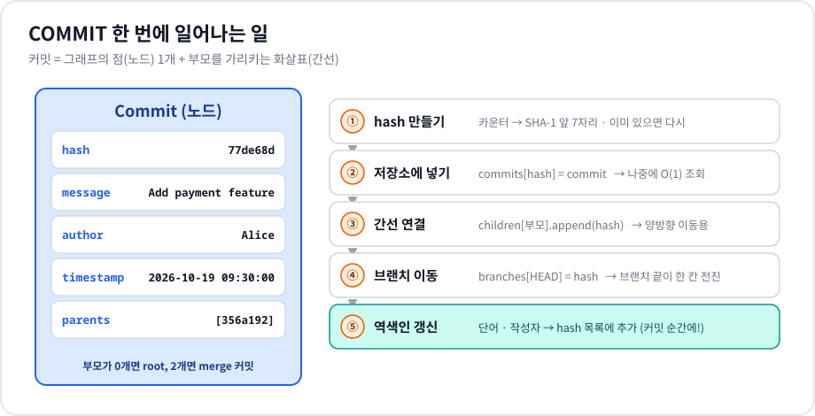

### 2-3. 역색인 갱신 시점

**Q. 커밋이 추가될 때 역색인(author/keyword)을 어떤 시점에, 어떤 방식으로 갱신하나?**

- **시점**: `Repository.commit()` 안에서 커밋을 저장소에 넣고 브랜치를 옮긴 **바로 다음** (위 그림 ⑤). 커밋 생성과 색인이 한 함수 안에서 함께 일어나므로 "커밋은 있는데 검색이 안 되는" 상태가 생기지 않습니다.
- **방식**:
  - `tokenize(message)` = `message.split()` 후 각 단어 `.lower()` → `keyword_index.add(단어, hash)`
  - `author_index.add(user.lower(), hash)`
  - 같은 메시지에 같은 단어가 두 번 있어도(`"fix fix"`) 목록 마지막 값과 비교해 **한 번만** 추가
- 검색 시점에는 계산 없이 **꺼내기만** 합니다. (→ [3-5](#3-5-역색인-vs-순회-검색))

### 2-4. 그래프 탐색 로직 재사용

**Q. LOG, PATH, ANCESTORS 의 그래프 탐색 로직을 어떻게 재사용 가능하게 만들었나?**

`graph.py` 의 함수들은 Repository를 모르고, **"이 노드의 이웃을 돌려주는 함수"를 인자로 받습니다.** 이웃 함수만 바꾸면 같은 BFS로 다른 질문에 답합니다.

| 명령 | 쓰는 함수 | 넘기는 이웃 함수 |
|---|---|---|
| ANCESTORS | `find_ancestors` → `bfs_order` | `_parents_of` (부모만) |
| PATH | `shortest_path` → `bfs_distances` | `_undirected_neighbors` (부모 + 자식) |
| LOG | `topological_order` | `_parents_of` (진입 차수), `_children_of` (차수 감소) |

```python
# repository.py
def _undirected_neighbors(self, commit_hash):
    return self._parents_of(commit_hash) + self._children_of(commit_hash)

def path(self, start, goal):
    ...
    return shortest_path(start, goal, self._undirected_neighbors)
```

덕분에 항목 4-2처럼 "PATH를 부모 방향만으로" 바꿀 때도 BFS 코드는 그대로 두고 **넘기는 이웃 함수만** 바꾸면 됩니다. 테스트도 Repository 없이 딕셔너리만으로 가능합니다 (1-4의 `python -c` 예시).

### 2-5. docstring · 주석 기준

**Q. 주요 함수/클래스에 docstring/주석을 어떤 기준으로 작성했나?**

1. **모든 모듈 맨 위**: 이 파일이 맡은 책임 (예: `graph.py` — "Repository를 모르고 이웃 함수만 받는다")
2. **모든 클래스와 공개 함수**: 무엇을 받고 무엇을 돌려주는지 + 실패하면 무엇이 되는지 (`None`, 에러)
3. **알고리즘 함수**: 단계(1, 2, 3…)와 **시간복잡도**를 적음 (`shortest_path`, `topological_order`, `merge_sort`)
4. **한 줄 주석은 "왜"만**: 코드만 봐선 이유가 안 보이는 곳 — 예: `_merge` 의 "값이 같으면 왼쪽 먼저 → 안정 정렬", `InvertedIndex.add` 의 "마지막 값만 봐도 중복 확인이 충분한 이유"
5. 코드를 그대로 읽어 주는 주석(`i += 1  # i를 1 증가`)은 쓰지 않음

---

## 항목 3 · 개념을 설명할 수 있나?

### 3-1. 왜 DAG 인가

**Q. 커밋 그래프가 왜 DAG여야 하는지, 사이클이 생기면 어떤 문제가 생기는지?**

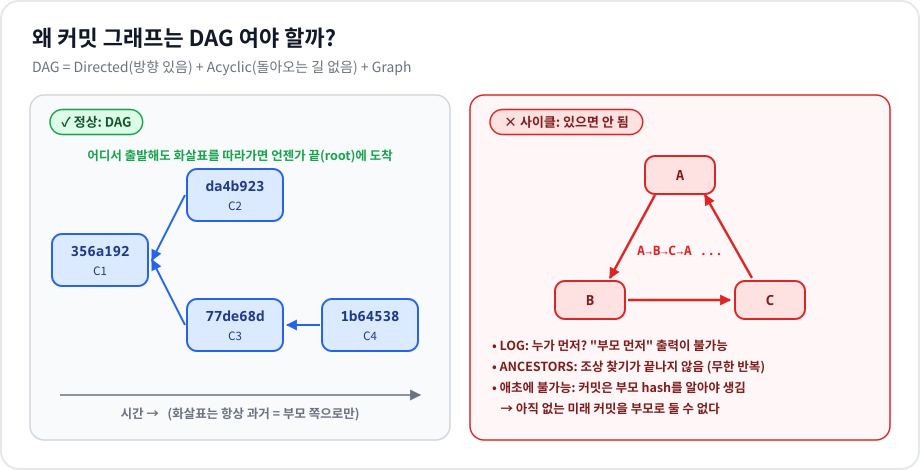

- **방향(Directed)**: 커밋은 "내 부모는 누구"만 기억합니다. 자식 → 부모 한 방향.
- **비순환(Acyclic)**: 커밋을 만들 때 부모는 **이미 존재하는** 커밋이어야 합니다. 미래에 생길 커밋을 부모로 가리킬 수 없으니 화살표를 따라가면 시간은 계속 과거로만 가고, 출발점으로 돌아올 수 없습니다.
- 사이클이 생기면:
  - **LOG**: A의 부모가 C, C의 부모가 B, B의 부모가 A라면 누구를 먼저 출력해야 할지 정할 수 없음 → 위상 정렬 불가 (`topological_order` 는 이 경우 `ValueError`)
  - **ANCESTORS**: visited 없이 따라가면 영원히 돌고, 있어도 "조상이 자기 자신"이라는 말이 안 되는 결과
  - **의미**: "이 변경은 저 변경 다음에 일어났다"는 시간 순서가 깨짐

### 3-2. LOG 위상 정렬

**Q. LOG에서 "부모가 먼저" 조건을 만족시키기 위해 어떤 접근을 적용했나?**

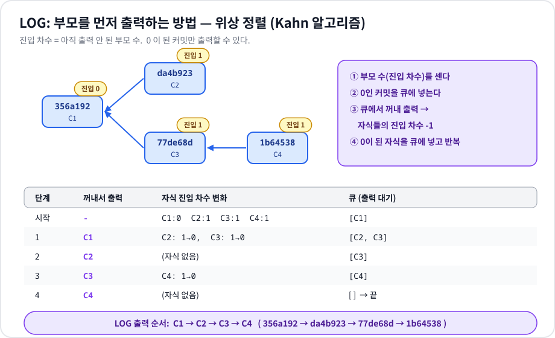

- **위상 정렬(Kahn 알고리즘)**: 진입 차수 = 아직 출력 안 된 부모 수. 0인 커밋만 출력하고, 출력할 때마다 자식의 진입 차수를 1 줄입니다.
- "진입 차수가 0" = "부모가 모두 이미 출력됨"이므로 조건이 **정의상 보장**됩니다.
- 처음 큐에 넣는 순서를 커밋 생성 순서로 해서, 동시에 출력 가능한 커밋끼리는 먼저 만든 것이 먼저 나옵니다.
- 단순히 "최신순/시간순"이 아니라 **그래프 관계로** 순서를 정한다는 점이 핵심입니다. 시간은 컴퓨터 시계에 따라 틀릴 수 있지만 부모-자식 관계는 틀릴 수 없습니다.
- 시간복잡도 O(V + E).

### 3-3. PATH BFS와 무방향 간선

**Q. PATH에서 최단 경로를 찾기 위해 어떤 알고리즘을 선택했고, 간선을 무방향으로 정의한 이유는?**

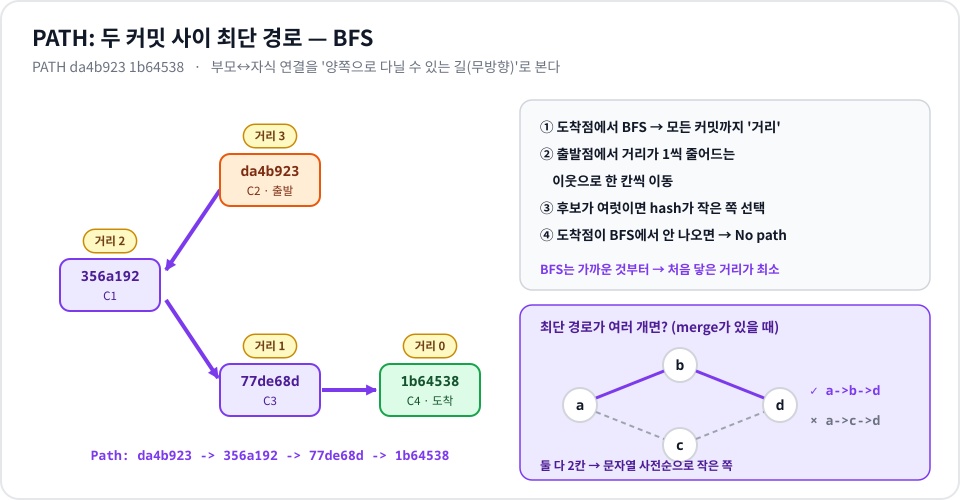

- **BFS 선택 이유**: 모든 간선의 비용이 1(한 칸)로 같습니다. BFS는 거리 1인 커밋을 모두 본 다음 거리 2로 넘어가므로, **어떤 커밋에 처음 도착한 순간의 거리가 최단 거리**입니다. (가중치가 있었다면 다익스트라가 필요했을 것)
- **무방향 이유**: 서로 다른 브랜치의 커밋(`da4b923` 과 `1b64538`)은 서로 조상이 아닙니다. 부모 방향만 허용하면 "다른 가지에 있는 커밋" 사이 거리는 항상 `No path` 가 되어 쓸모가 없습니다. 무방향으로 보면 **공통 조상까지 올라갔다가 내려오는 길**이 생겨, 두 커밋이 이력상 몇 칸 떨어져 있는지 알 수 있습니다.
- **사전순 최소**: 도착점에서 BFS로 거리를 구한 뒤, 출발점부터 "거리가 1 줄어드는 이웃 중 가장 작은 hash"를 한 칸씩 고릅니다. hash 길이가 모두 7로 같아 칸 단위 비교 = 문자열 비교.
- 시간복잡도 O(V + E).

### 3-4. 정렬 알고리즘 복잡도와 안정성

**Q. 정렬 알고리즘의 평균/최악 시간복잡도와 안정 정렬 여부는?**

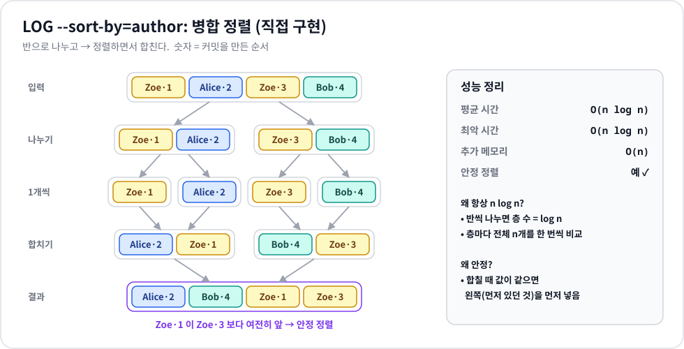

| | 병합 정렬 (이 프로젝트) | 참고: 퀵 정렬 | 참고: 삽입 정렬 |
|---|---|---|---|
| 평균 | O(n log n) | O(n log n) | O(n²) |
| 최악 | **O(n log n)** | O(n²) | O(n²) |
| 안정 | **예** | 아니오 | 예 |
| 추가 메모리 | O(n) | O(log n) | O(1) |

- **왜 항상 n log n**: 반씩 나누면 층이 log n개, 각 층에서 n개를 한 번씩 비교하며 합침.
- **왜 안정**: `_merge` 에서 `key(right) < key(left)` 일 때만 오른쪽을 먼저 넣습니다. 같으면 왼쪽(원래 앞에 있던 것)이 먼저 → 같은 작성자의 커밋은 만든 순서 유지 (1-6의 Zoe 예시).

### 3-5. 역색인 vs 순회 검색

**Q. 역색인이 순회 검색보다 빠른 이유를 자료구조/시간복잡도 관점에서?**

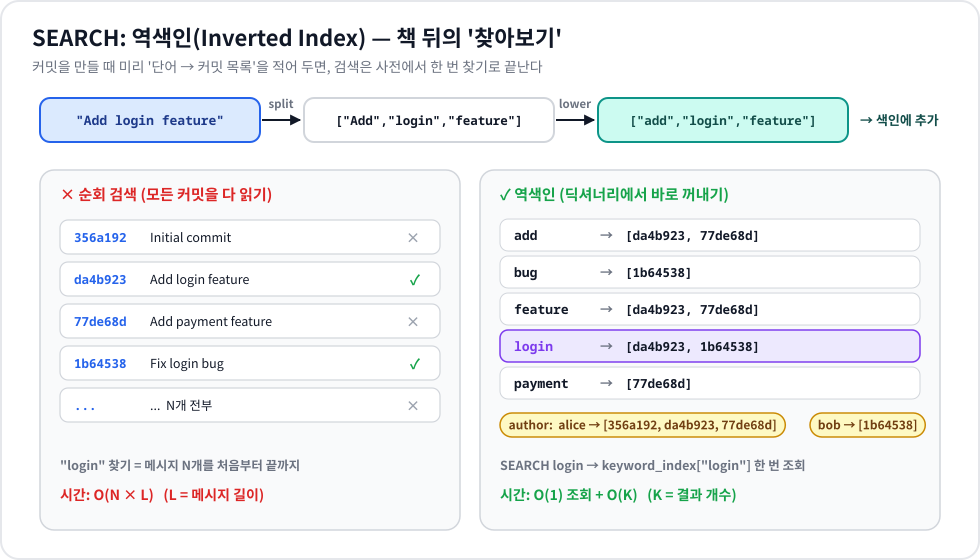

| | 순회 검색 | 역색인 |
|---|---|---|
| 자료구조 | 커밋 목록 | `dict[단어 → hash 목록]` |
| 검색 1회 | 모든 커밋 메시지를 나눠 비교 **O(N × L)** | 해시 테이블 조회 **O(1)** + 결과 복사 **O(K)** |
| 미리 하는 일 | 없음 | 커밋할 때 단어 수만큼 추가 O(L) |

- N = 커밋 수, L = 메시지 길이, K = 결과 개수.
- 핵심은 **일을 검색할 때가 아니라 커밋할 때 미리 해 두는 것**입니다. 커밋은 한 번, 검색은 여러 번 하므로 전체 비용이 줄어듭니다.
- 결과와 상관없는 커밋은 아예 보지 않습니다 — N이 10배가 돼도 "login" 이 들어간 커밋이 그대로면 검색 시간도 그대로.

---

## 항목 4 · 바뀌면 어떻게 할까?

### 4-1. 커밋 수가 10배가 되면

**Q. 커밋 수가 10배 늘었을 때 병목이 될 지점과 개선 방향은?**

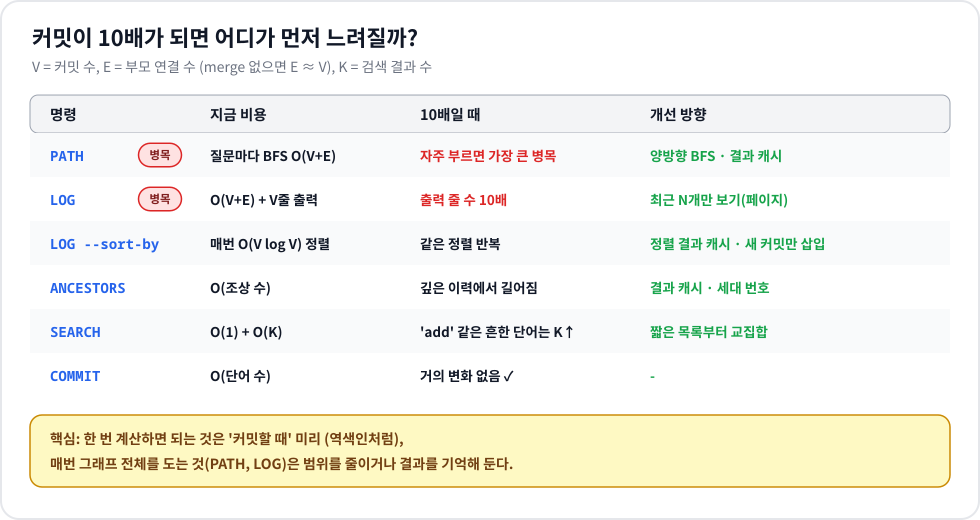

1. **PATH** — 질문할 때마다 도착점에서 BFS를 그래프 전체에 돌립니다. 가까운 두 커밋을 물어도 O(V+E).
   → 출발점을 만나면 BFS를 멈추기 (그 뒤 거리는 필요 없음), 양쪽에서 동시에 넓혀 가는 **양방향 BFS**, 자주 묻는 쌍은 결과 캐시.
2. **LOG** — 정렬 자체는 O(V+E)로 괜찮지만 출력 줄 수가 10배. 또 커밋마다 `branches_at()` 이 모든 브랜치를 훑으므로 브랜치가 많으면 O(V × B).
   → 최근 N개만 보여주기(페이지), LOG 시작 시 `hash → 브랜치 목록` 을 한 번만 만들기.
3. **LOG --sort-by** — 부를 때마다 O(V log V) 다시 정렬.
   → 커밋은 추가만 되므로 정렬 결과를 캐시하고 새 커밋만 제자리에 삽입. 특히 date 기준은 커밋 생성 순서가 곧 시간 순서라 사실상 정렬이 필요 없음.
4. **SEARCH** — 조회는 O(1)이지만 `add` 같은 흔한 단어는 결과 K가 커짐. 여러 단어 검색은 첫 단어 목록을 기준으로 거름.
   → 가장 짧은 목록부터 교집합, 흔한 단어(불용어) 제외.
5. **COMMIT · ANCESTORS** — 커밋은 메시지 길이에만 비례해 영향 거의 없음. ANCESTORS는 출력할 조상 수만큼은 어쩔 수 없음 (필요하면 결과 캐시).

### 4-2. PATH 를 "부모 방향만" 허용하면

**Q. PATH의 간선 정의를 "부모 방향만 허용"으로 바꾸면 결과가 어떻게 달라지고, 구현은 무엇을 바꿔야 하나?**

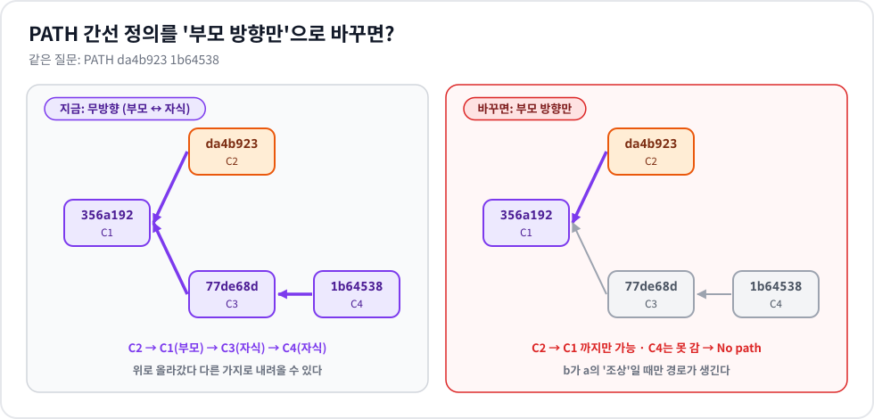

- **결과 변화**: `a → b` 경로는 **b가 a의 조상일 때만** 존재합니다.
  - `PATH 1b64538 356a192` → 그대로 `1b64538 -> 77de68d -> 356a192`
  - `PATH da4b923 1b64538` (다른 가지) → `No path`
  - `PATH 356a192 1b64538` (부모 → 자식 방향으로 묻기) → `No path`
  - 즉 PATH가 "ANCESTORS 안에서 특정 조상까지의 최단 거리"로 바뀝니다.
- **구현 변경**: BFS 코드는 그대로, 넘기는 이웃 함수만 바꿉니다. 다만 주의할 점이 하나 있습니다.
  - `shortest_path` 는 ① **도착점에서** BFS로 거리를 구하고 ② **출발점에서** 걸어갑니다.
  - 무방향일 때는 두 방향의 이웃이 같아서 함수 하나로 충분했지만, 방향이 생기면 ①은 거꾸로 가야 합니다.
  - 그래서 `neighbors` 인자를 둘로 나눕니다: ① 거리 계산용 = `_children_of` (부모 방향의 반대), ② 걸어가기용 = `_parents_of`.

```python
def shortest_path(start, goal, forward, backward):
    dist = bfs_distances(goal, backward)   # ① 도착점에서 거꾸로
    ...
    for nxt in forward(node):              # ② 출발점에서 앞으로
        ...

# repository.py
shortest_path(start, goal, self._parents_of, self._children_of)                     # 부모 방향만
shortest_path(start, goal, self._undirected_neighbors, self._undirected_neighbors)  # 지금(무방향)
```

  `_parents_of` 하나만 넘기면 도착점의 **조상** 쪽으로 거리를 재게 되어 `PATH 1b64538 356a192` 도 `No path` 가 되는 버그가 생깁니다 (직접 확인함).

### 4-3. author 정렬 + 부모-자식 순서 유지

**Q. `LOG --sort-by=author` 가 "부모-자식 선후도 유지"로 강화되면 어떤 전략으로 해결할까?**

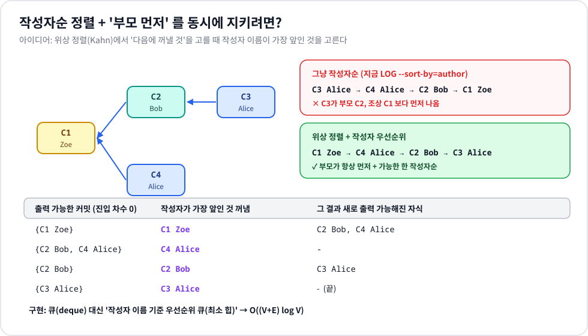

- 일반 정렬은 커밋끼리 **한 쌍씩만** 비교하기 때문에 "부모가 먼저"라는 그래프 조건을 지킬 수 없습니다 (그림의 위쪽 빨간 예).
- **전략: 위상 정렬 + 우선순위**. Kahn 알고리즘은 그대로 두고, "지금 출력 가능한(진입 차수 0) 커밋 중 무엇을 먼저 꺼낼지"만 **작성자 이름이 가장 앞인 것**으로 정합니다.
  - 부모 먼저 → 위상 정렬이 보장
  - 그 안에서 최대한 작성자순 → 우선순위가 보장
- **구현**: `topological_order` 의 `deque` 를 `(작성자, 생성 순서, hash)` 를 키로 하는 **최소 힙**으로 교체. 생성 순서를 키에 넣으면 같은 작성자끼리는 만든 순서(안정성)도 유지됩니다.
- 시간복잡도 O((V + E) log V).

### 4-4. 카운터 기반 ↔ 난수 기반 hash

**Q. 해시 생성 방식을 카운터 기반 ↔ 난수 기반으로 바꿀 때 테스트/재현성/디버깅에 미치는 영향은?**

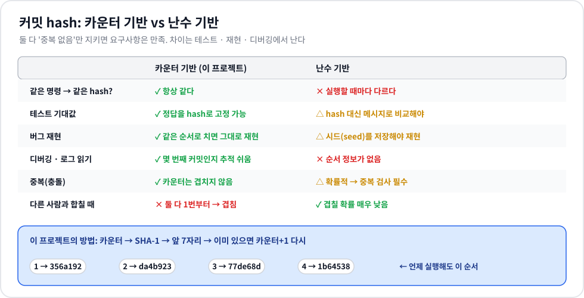

| | 카운터 기반 (현재) | 난수 기반 |
|---|---|---|
| **테스트** | 기대 출력에 hash를 그대로 적을 수 있음 (`[main 356a192]`) | 실행마다 hash가 달라 "hash를 뺀 나머지"로 비교하거나, 출력된 hash를 받아 다음 명령에 넣어야 함 |
| **재현성** | 같은 명령 순서 = 같은 hash. 문서 예시가 그대로 재현됨 | 시드(seed)를 고정·기록해야만 재현 가능 |
| **디버깅** | hash로 "몇 번째 커밋"인지 추적 가능, 버그 리포트의 hash를 그대로 다시 만들 수 있음 | 순서 정보가 없음. 리포트의 hash로 같은 상태를 다시 만들기 어려움 |
| **중복** | 카운터는 겹치지 않음 (자른 7자리만 검사) | 확률적으로 겹칠 수 있음 → 중복 검사 루프 필수 |
| **여러 저장소 합치기** | 서로 1번부터 세므로 겹침 | 겹칠 확률이 매우 낮음 (실제 Git은 내용 기반 SHA로 해결) |

이 과제는 한 세션 · 한 저장소 · 메모리 동작이고, 피어 평가에서 **같은 출력을 재현**하는 것이 중요해서 카운터 기반을 선택했습니다. 바꾸고 싶다면 `_new_hash()` 의 `str(self._counter)` 를 `secrets.token_hex()` 등으로 바꾸면 되고, 중복 검사 루프는 그대로 두면 됩니다.
