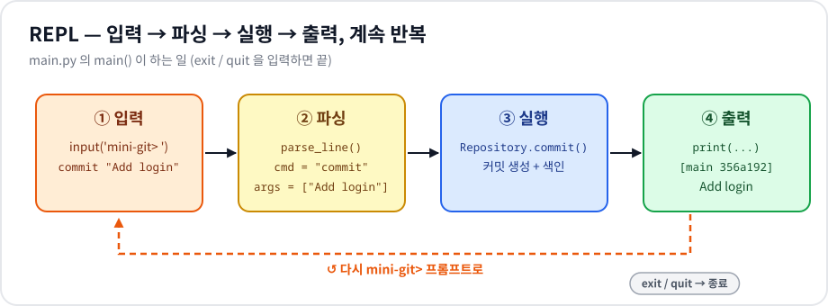

# Mini Git — 커밋 그래프로 배우는 Git의 속 구조

> **B5-2 · 파일이 언제 어떻게 바뀌었는지 기록하는 작은 프로그램 만들기**
> Git의 "커밋 · 브랜치 · HEAD · 로그 · 검색"을 메모리 위에서 직접 만들어 보며
> **그래프(DAG) · BFS · 위상 정렬 · 병합 정렬 · 역색인**을 손으로 확인하는 프로젝트입니다.

📋 **평가표 항목별 정리는 → [EVALUATION.md](EVALUATION.md)**

---

## 목차

0. [실행 방법](#0-실행-방법)
1. [이 프로그램이 하는 일](#1-이-프로그램이-하는-일)
2. [먼저 알아둘 개념 6가지](#2-먼저-알아둘-개념-6가지)
3. [단계별로 따라 하기](#3-단계별로-따라-하기)
4. [프로젝트 구조](#4-프로젝트-구조)
5. [핵심 알고리즘 쉽게 이해하기](#5-핵심-알고리즘-쉽게-이해하기)
6. [명령어 · 에러 메시지 정리](#6-명령어--에러-메시지-정리)
7. [요구사항 · 제약사항 체크](#7-요구사항--제약사항-체크)

---

## 0. 실행 방법

```bash
python main.py        # Python 3.10 이상, 설치할 라이브러리 없음
```

```text
mini-git> help
Commands:
  INIT <user_name>
  BRANCH <branch_name>
  SWITCH <branch_name>
  COMMIT <message>
  LOG [--sort-by=date|author]
  PATH <commit1> <commit2>
  ANCESTORS <commit_hash>
  SEARCH <keyword> | SEARCH --author=<name>
  EXIT | QUIT
```

- 명령어는 **대소문자 구분 없음** (`INIT`, `init`, `Init` 모두 OK)
- 공백이 들어간 글자는 **따옴표**로 감싸기: `COMMIT "Add login feature"`
- 데이터는 **메모리에만** 저장됩니다. 종료하면 사라집니다. (요구사항: 영속성 불필요)

---

## 1. 이 프로그램이 하는 일

`mini-git>` 프롬프트에서 명령을 한 줄 입력하면 **입력 → 파싱 → 실행 → 출력**을 하고, 다시 프롬프트로 돌아옵니다. 이렇게 계속 도는 구조를 **REPL**(Read-Eval-Print Loop)이라고 부릅니다.



| 단계 | 하는 일 | 코드 |
|---|---|---|
| ① 입력 | `input("mini-git> ")` 로 한 줄 받기 | `main.py` `main()` |
| ② 파싱 | 따옴표를 지키며 단어로 나누고, 명령어는 소문자로 | `main.py` `parse_line()` |
| ③ 실행 | 명령어 이름으로 처리 함수를 찾아 실행 | `main.py` `MiniGitCLI.execute()` |
| ④ 출력 | 결과(또는 에러 메시지)를 글자로 출력 | `main.py` `print(...)` |

---

## 2. 먼저 알아둘 개념 6가지

| 개념 | 한 줄 설명 | 쉬운 비유 |
|---|---|---|
| **커밋 (commit)** | "이 시점에 이런 변경을 했다"는 기록 1개. `hash, message, author, timestamp, parents` 를 가진다 | 일기장의 한 페이지 |
| **부모 (parent)** | 이 커밋 바로 앞의 커밋. 커밋은 부모를 **가리킨다** | "이전 페이지 보기" 링크 |
| **브랜치 (branch)** | 어떤 커밋을 가리키는 **이름표**. 커밋하면 이름표가 새 커밋으로 한 칸 이동 | 책갈피 |
| **HEAD** | "지금 내가 어느 브랜치에 있는가" | 지금 손에 든 책갈피 |
| **hash** | 커밋을 구별하는 짧은 이름 (예: `356a192`). 겹치면 안 됨 | 주민번호 |
| **DAG** | 화살표에 방향이 있고(Directed), 따라가도 다시 돌아오지 않는(Acyclic) 그래프 | 족보 (조상 → 자손으로만 이어짐) |

> 커밋 = **점(노드)**, 부모를 가리키는 화살표 = **선(간선)**.
> 그래서 Git 이력은 **그래프**이고, LOG · PATH · ANCESTORS 는 모두 **그래프 탐색**입니다.

---

## 3. 단계별로 따라 하기

아래 명령을 차례대로 입력하면서 그래프가 어떻게 자라는지 보세요.
hash는 실행할 때마다 **항상 같은 값**이 나옵니다(→ [5-7](#5-7-커밋-hash-만들기)). 시간은 실행 시각에 따라 다릅니다.


### Step 1. 저장소 만들기 — `INIT`

```text
mini-git> init "Alice"
Initialized repository.
Current branch: main
Current user: Alice
```

`main` 브랜치가 생기고, HEAD는 `main`, 작성자는 `Alice` 입니다. 아직 커밋은 없습니다.

### Step 2. 첫 커밋 — `COMMIT`

```text
mini-git> commit "Initial commit"
[main 356a192] Initial commit
```

부모가 없는 첫 커밋(**root**)이 생기고, `main` 이름표가 이 커밋을 가리킵니다.

### Step 3. 브랜치 만들고 옮겨 가기 — `BRANCH`, `SWITCH`

```text
mini-git> branch feature
Created branch: feature
mini-git> switch feature
Switched to branch: feature
mini-git> commit "Add login feature"
[feature da4b923] Add login feature
```

`feature` 는 만들어질 때 **지금 HEAD 커밋(356a192)** 을 가리킵니다. HEAD를 `feature` 로 옮긴 뒤 커밋하면 `feature` 쪽에만 새 커밋이 쌓입니다.

### Step 4. 다시 main 으로 — 가지가 갈라진다

```text
mini-git> switch main
Switched to branch: main
mini-git> commit "Add payment feature"
[main 77de68d] Add payment feature
```

`da4b923` 과 `77de68d` 는 **같은 부모(356a192)** 를 가집니다. 이력이 두 갈래가 되었습니다.

### Step 5. 다른 사람으로 커밋하기

```text
mini-git> init "Bob"
Repository already initialized.
Current user: Bob
mini-git> commit "Fix login bug"
[main 1b64538] Fix login bug
```

이미 저장소가 있으면 `INIT` 은 **기록은 그대로 두고 작성자만 바꿉니다.** (작성자 검색/정렬을 실습하기 위해)

### Step 6. 이력 보기 — `LOG` (부모가 항상 먼저)

```text
mini-git> log
commit 356a192 (Alice, 2026-10-19 09:00:00)
    parents: (none)
    Initial commit
commit da4b923 (Alice, 2026-10-19 09:15:00) [feature]
    parents: 356a192
    Add login feature
commit 77de68d (Alice, 2026-10-19 09:30:00)
    parents: 356a192
    Add payment feature
commit 1b64538 (Bob, 2026-10-19 09:45:00) [HEAD -> main]
    parents: 77de68d
    Fix login bug
```

`parents:` 줄을 보면 **어떤 커밋도 자기 부모보다 먼저 나오지 않습니다.** `[...]` 는 그 커밋을 가리키는 브랜치입니다.

### Step 7. 그래프 탐색 — `PATH`, `ANCESTORS`

```text
mini-git> path da4b923 1b64538
Path: da4b923 -> 356a192 -> 77de68d -> 1b64538
mini-git> ancestors 1b64538
Ancestors of 1b64538 (2 commits):
- 77de68d: Add payment feature (Alice)
- 356a192: Initial commit (Alice)
```

- **PATH**: 부모↔자식을 양쪽으로 다닐 수 있다고 보고 **가장 짧은 길**을 찾습니다. 경로가 없으면 `No path`.
- **ANCESTORS**: 부모 쪽으로만 끝까지 따라가 **모든 조상**을 찾습니다. `da4b923` 은 형제 가지라서 조상이 아닙니다.

### Step 8. 검색과 정렬 — `SEARCH`, `LOG --sort-by`

```text
mini-git> search "login"
Found 2 commits:
- da4b923: Add login feature (Alice)
- 1b64538: Fix login bug (Bob)
mini-git> search "add feature"
Found 2 commits:
- da4b923: Add login feature (Alice)
- 77de68d: Add payment feature (Alice)
mini-git> search --author=bob
Found 1 commit:
- 1b64538: Fix login bug (Bob)
mini-git> exit
Bye!
```

- 검색은 대소문자를 구분하지 않습니다 (`login` = `LOGIN`).
- 여러 단어(`"add feature"`)는 **모든 단어가 들어 있는 커밋**만 찾습니다.
- `LOG --sort-by=author` / `--sort-by=date` 는 LOG와 같은 형식으로, 작성자 이름순 / 시간순으로 출력합니다. 작성자가 섞인 예시는 [EVALUATION.md 1-6](EVALUATION.md#1-6-search--log---sort-by)에 있습니다.

---

## 4. 프로젝트 구조

```text
codyssey_b5-2/
├── main.py                 # 엔트리 포인트: REPL, 명령 파싱, 출력 형식
├── minigit/
│   ├── repository.py       # Repository: 커밋 저장소, 브랜치, HEAD, 사용자, 역색인
│   ├── graph.py            # BFS, 최단 경로, 조상 탐색, 위상 정렬
│   ├── sorting.py          # 병합 정렬 (sorted / list.sort 미사용)
│   └── index.py            # 토큰화, 역색인(InvertedIndex)
├── docs/images/            # README · EVALUATION 그림 (직접 제작한 SVG)
├── README.md
└── EVALUATION.md           # 평가표 항목별 답변
```


**원칙: 화면 / 데이터 / 알고리즘을 나눈다.**

- `main.py` 는 글자를 읽고 쓰기만 합니다. 커밋 그래프를 직접 만지지 않습니다.
- `Repository` 는 데이터를 가지고 "어떤 알고리즘을 어떤 데이터로 부를지"만 정합니다.
- `graph.py`, `sorting.py`, `index.py` 는 **Repository를 모릅니다.** 입력만 받아 계산하므로 따로 떼어 테스트하고 재사용할 수 있습니다.

### COMMIT 한 번에 일어나는 일


`Repository.commit()` 은 위 5단계를 한 번에 처리합니다. **역색인은 커밋이 만들어지는 순간 갱신**되므로, 검색할 때는 이미 만들어진 표에서 꺼내기만 하면 됩니다.

---

## 5. 핵심 알고리즘 쉽게 이해하기

### 5-1. 커밋 그래프는 왜 DAG 일까?


- 커밋은 **만들어질 때 이미 존재하는 커밋만** 부모로 가질 수 있습니다. 미래의 커밋을 부모로 가리킬 방법이 없으니 화살표는 언제나 **과거 방향**이고, 따라가도 **절대 출발점으로 돌아오지 않습니다.** → 사이클이 생길 수 없음
- 만약 사이클이 있다면 "부모 먼저" 순서를 정할 수 없고, 조상 찾기가 끝나지 않습니다.
- 이 프로젝트는 `COMMIT` 이 **현재 HEAD(이미 있는 커밋)만 부모로 쓰기 때문에** 구조적으로 DAG가 보장됩니다. 그래도 `topological_order()` 는 사이클을 발견하면 `ValueError` 를 내도록 안전장치를 두었습니다.

### 5-2. LOG — 위상 정렬로 "부모 먼저" 출력하기


**Kahn 알고리즘** (`minigit/graph.py` · `topological_order`)

1. 각 커밋의 **진입 차수 = 부모 수** 를 센다.
2. 진입 차수가 0인 커밋(root)을 큐에 넣는다.
3. 큐에서 하나 꺼내 출력하고, 그 **자식들의 진입 차수를 1 줄인다.**
4. 0이 된 자식을 큐에 넣고 큐가 빌 때까지 반복.

진입 차수가 0이 된다는 것 = "내 부모가 모두 출력됐다"는 뜻이므로 **부모가 항상 먼저** 나옵니다.
처음 큐에 넣을 때 커밋을 **만든 순서대로** 넣기 때문에, 동시에 출력 가능한 커밋끼리는 먼저 만든 것이 먼저 나옵니다.
시간복잡도는 **O(V + E)** (V = 커밋 수, E = 부모 연결 수).

### 5-3. PATH — BFS로 최단 경로 찾기


- **간선을 무방향으로 보는 이유**: `da4b923` 과 `1b64538` 은 서로의 조상이 아닙니다. 부모 방향으로만 가면 영원히 만날 수 없지만, "공통 조상까지 올라갔다가 다른 가지로 내려오는 길"은 있습니다. 두 커밋이 **이력상 얼마나 떨어져 있는지**를 재려면 양쪽으로 다녀야 합니다.
- **BFS를 쓰는 이유**: 간선마다 비용이 1로 같을 때 BFS는 가까운 커밋부터 차례로 방문하므로, **처음 도착한 거리가 곧 최단 거리**입니다.
- **사전순 최소 경로** (`minigit/graph.py` · `shortest_path`)
  1. 도착점에서 BFS를 한 번 돌려 모든 커밋의 "도착점까지 남은 거리"를 구합니다.
  2. 출발점에서 남은 거리가 정확히 1 줄어드는 이웃 중 **hash가 가장 작은 것**을 골라 한 칸씩 이동합니다.
  3. 모든 hash 길이가 7자리로 같으므로, 앞에서부터 가장 작은 hash를 고르면 `"a->b->c"` 문자열 전체로 봐도 가장 작은 경로가 됩니다.
- 도착점이 BFS에서 한 번도 나오지 않으면 → `No path`.
  (예: 첫 커밋 전에 `BRANCH` 를 만들고 그 브랜치에서도 커밋하면 root가 2개인 떨어진 그래프가 생깁니다. → [EVALUATION.md](EVALUATION.md#1-4-path))

> 💡 이 프로젝트는 보너스(merge)를 구현하지 않았기 때문에 그래프가 나무 모양이고, 최단 경로가 항상 하나입니다. 사전순 규칙은 merge 커밋이 생겨 같은 길이의 경로가 여러 개가 될 때 쓰이며, 함수 단위로 따로 확인했습니다 (EVALUATION.md 참고).

### 5-4. ANCESTORS — 부모 방향으로만 BFS


`find_ancestors()` 는 **PATH와 같은 BFS 함수(`bfs_order`)를 그대로 쓰고 "이웃 = 부모 목록"만 넘깁니다.** `visited` 집합 덕분에 같은 조상을 여러 길로 만나도 한 번만 출력하고, 도달 가능한 조상은 빠짐없이 모두 방문합니다.

### 5-5. 정렬 — 병합 정렬 직접 구현


`sorted()`, `list.sort()` 는 쓰지 않고 `minigit/sorting.py` 에 **병합 정렬**을 직접 만들었습니다.

| | 병합 정렬 |
|---|---|
| 평균 시간 | O(n log n) |
| 최악 시간 | O(n log n) — 입력이 어떻든 항상 반씩 나누기 때문 |
| 추가 메모리 | O(n) |
| 안정 정렬 | **예** — 합칠 때 값이 같으면 왼쪽(원래 앞에 있던 것)을 먼저 넣음 |

비교 기준은 `key` 함수로 바꿉니다. 같은 함수로 날짜 정렬과 작성자 정렬을 모두 처리합니다.

```python
merge_sort(commits, key=lambda c: c.timestamp)       # --sort-by=date
merge_sort(commits, key=lambda c: c.author.lower())  # --sort-by=author
```

병합 정렬을 고른 이유: 작성자가 같은 커밋이 많을 때 **만든 순서가 유지되어야(안정 정렬)** 결과가 예측 가능하고, 퀵 정렬과 달리 **최악에도 O(n log n)** 이 보장됩니다.

### 5-6. SEARCH — 역색인


- 커밋할 때 메시지를 **공백으로 나누고(split) 소문자로 바꾼(lower)** 단어마다 `단어 → [커밋 hash...]` 목록에 추가합니다. 작성자도 `작성자 → [커밋 hash...]` 로 따로 저장합니다.
- 검색은 딕셔너리에서 **키 하나로 바로 꺼내기**: O(1) + 결과 K개 복사 O(K).
- 역색인이 없다면 모든 커밋 메시지를 처음부터 읽어야 하므로 O(N × L) 입니다. 커밋 수 N이 커질수록 차이가 벌어집니다.

### 5-7. 커밋 hash 만들기


`카운터(1, 2, 3, …) → SHA-1 → 앞 7자리`. 생성된 hash가 이미 있으면 카운터를 올려 다시 만들기 때문에 **세션 안에서 중복이 절대 생기지 않습니다.** 같은 순서로 명령하면 항상 같은 hash가 나오므로 문서의 예시와 실제 실행 결과가 일치하고, 테스트와 버그 재현이 쉽습니다.

---

## 6. 명령어 · 에러 메시지 정리

| 명령 | 하는 일 | 예시 |
|---|---|---|
| `INIT <user_name>` | 저장소 생성, `main` 브랜치, HEAD=main, 작성자 설정 (이미 있으면 작성자만 변경) | `init "Alice"` |
| `BRANCH <branch_name>` | 지금 HEAD 커밋을 가리키는 새 브랜치 | `branch feature` |
| `SWITCH <branch_name>` | HEAD를 그 브랜치로 이동 | `switch feature` |
| `COMMIT <message>` | HEAD를 부모로 하는 새 커밋 + 역색인 갱신 | `commit "Add login"` |
| `LOG` | 부모가 항상 먼저 나오는 순서(위상 정렬) | `log` |
| `LOG --sort-by=date\|author` | 날짜 / 작성자 기준 병합 정렬 | `log --sort-by=author` |
| `PATH <c1> <c2>` | 무방향 최단 경로, 없으면 `No path` | `path da4b923 1b64538` |
| `ANCESTORS <hash>` | 모든 조상 | `ancestors 1b64538` |
| `SEARCH <keyword>` | 메시지에 단어가 있는 커밋 (역색인) | `search login` |
| `SEARCH --author=<name>` | 작성자의 커밋 (역색인) | `search --author=bob` |
| `EXIT` / `QUIT` | 종료 | `exit` |

| 상황 | 출력 |
|---|---|
| 인자 개수/형식이 틀림 | `Invalid args` + `Usage: ...` |
| 따옴표 짝이 안 맞음 | `Invalid args (check your quotes)` |
| 없는 브랜치 | `Unknown branch: <name>` |
| 없는 커밋 | `Unknown commit: <hash>` |
| 이미 있는 브랜치 이름 | `Branch already exists: <name>` |
| 모르는 명령 | `Unknown command: <cmd> (type HELP)` |
| INIT 전에 다른 명령 | `Not initialized. Run INIT <user_name> first.` |

---

## 7. 요구사항 · 제약사항 체크

| 요구사항 | 어디서 / 어떻게 |
|---|---|
| 명령어 대소문자 무시 | `parse_line()` 에서 `tokens[0].lower()` |
| 공백 포함 인자는 따옴표 | `shlex.split()` 이 따옴표 안을 한 덩어리로 유지 |
| 커밋 필드 hash/message/author/timestamp/parents | `Commit` dataclass (`repository.py`) |
| hash로 빠른 조회 | `self.commits: dict` (해시맵, O(1)) |
| hash 세션 내 유일 | `_new_hash()`: 카운터 + 중복 검사 루프 |
| DAG | 부모는 항상 이미 있는 커밋 / `topological_order` 사이클 검사 |
| 역색인 2종 (keyword, author) | `keyword_index`, `author_index` (`index.py`) |
| 키워드 = split + lower | `tokenize()` |
| 정렬 직접 구현, 기준 변경 가능 | `merge_sort(items, key)` |
| 알고리즘 로직 분리 | `graph.py`, `sorting.py`, `index.py` |
| docstring / 주석 | 모든 모듈·클래스·주요 함수 |
| 그래프 라이브러리 미사용 | 표준 라이브러리 `collections.deque`, `hashlib`, `shlex`, `datetime` 만 사용 |
| 보너스(diff, merge, 성능 비교) | **구현하지 않음** (요청 범위 밖) |

`sorted()` / `.sort()` 를 쓰지 않았는지 직접 확인:

```bash
grep -rnE "(^|[^_[:alnum:]])sorted\(|\.sort\(" --include=*.py .
# → sorting.py 첫 줄 주석(사용 금지 설명)만 나오고, 실제 호출은 0건
```

---

## 그림에 대해

`docs/images/` 의 그림은 모두 이 프로젝트를 위해 **직접 만든 SVG** 입니다. 그림 속 hash(`356a192`, `da4b923`, `77de68d`, `1b64538`)는 [3장 단계별 따라 하기](#3-단계별로-따라-하기)를 실행했을 때 실제로 나오는 값과 같습니다.
